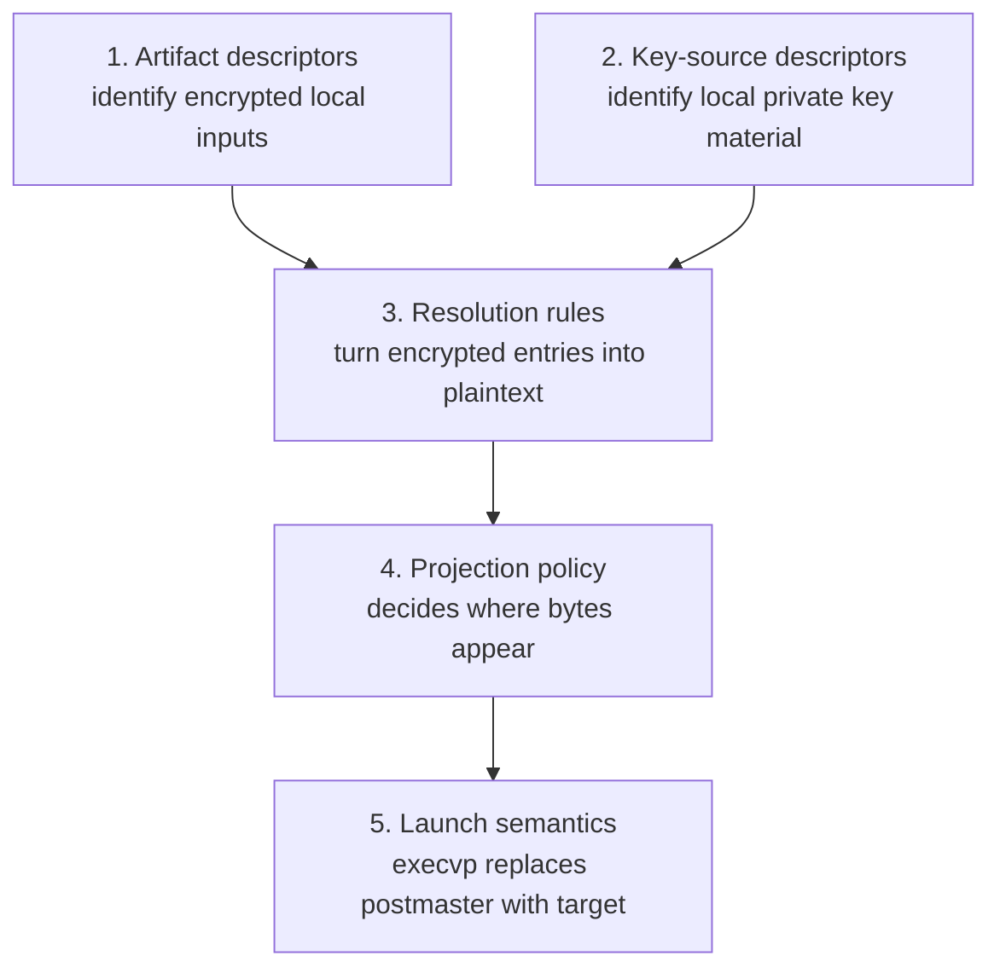

# Materialization ABI

`postmaster` is the local secret materialization engine. Its ABI is the
contract between public deployment artifacts, local private key material,
and the process that receives plaintext at runtime.

## Audience Quickstart (Plain Language)

**What this is:** the contract that every integration (Nix, Terraform,
CDK, Ansible, etc.) must follow when wiring postmaster. If you're writing
a binding or evaluating whether a generated config is correct, this is
your page.

### Who this is for

| Reader | What to take |
| -------- | ------------ |
| Integration author | The entire page — this is your contract |
| Security engineer | "Non-goals" and "Resolution" — what postmaster will never do |
| New user | "Current ABI instance" and the exec.json example — the 60-second tour |
| Platform / SRE | "Key sources" and "Validation" — what the host needs |

### Quick glossary

| Term | Plain meaning |
| ------ | --------------- |
| **ABI** | Application Binary Interface — the contract between config files, key material, and the launcher |
| **exec.json** | A JSON file that tells postmaster what to decrypt, how to inject, and what to launch |
| **Projection** | Where decrypted secrets go — env vars, files, or systemd credentials |
| **Adapter** | An input format (.env, postmaster_bundle) — postmaster supports multiple, not just one |

The ABI is deliberately local:

- encrypted secret artifacts may be public and declarative
- private key material arrives through local terminal sources
- `postmaster` decrypts and projects plaintext on the host
- plaintext is handed to the target process through one selected projection
- failure happens before `exec`, not after a partially configured launch

This page describes the ABI and how `exec.json` fits inside it. It is a
contract for bindings and documentation recipes, not an invitation to put
provider clients into `postmaster`.

## Non-goals

`postmaster` must not become:

- an AWS SSM client
- a Vault client
- a Terraform/OpenTofu/CDK/Ansible/Salt/Puppet plugin host
- a general remote secret-store SDK wrapper
- a process that fetches secrets over the network in the secret path

Vault, AWS SSM, 1Password, and other centralized stores are source or
custody systems. Automation tools (Nix, CDK, Ansible, SaltStack, Puppet,
Terraform, OpenTofu) are renderers and installers. Their job is to deliver
local artifacts, local key material, config, and service wiring around the
ABI. Runtime decrypt and injection remain inside `postmaster`.

## Contract layers

The ABI has five layers.



1. Artifact descriptors identify encrypted local inputs.
2. Key-source descriptors identify local private key material.
3. Resolution rules turn encrypted entries into named plaintext byte values.
4. Projection policy decides where those bytes may appear.
5. Launch semantics replace the wrapper process with the target command only
   after validation and materialization succeed.

All ABI data intended for generated config must be safe to store in the Nix
store or an equivalent world-readable deployment artifact. Secret bytes and
private keys are never config fields.

## Current ABI instance

`exec.json` is the first ABI instance. It is implicitly:

- ABI version: `0`
- input adapter: `.env` (wire-compatible with dotenvx-encrypted files)
- artifact shape: `env_files`
- key material shape: `.env.keys` / `DOTENV_PRIVATE_KEY*`
- projection modes: `env`, `files`, and `credentials`

The current parser does not accept explicit `version` or `adapter` fields.
Bindings must not emit those fields until the Rust parser and schema define
them.

The current shape is:

```json
{
  "mode": "files",
  "keys": [{ "credential": "postmaster-myapp" }, "environment"],
  "env_files": ["/nix/store/.../.env.production"],
  "strict": true,
  "overload": false,
  "secrets_dir": "/run/postmaster",
  "passthrough": ["RUST_LOG"]
}
```

`env_files` are encrypted `.env` files, wire-compatible with dotenvx. They
must follow the `.env[.<environment>]` basename convention because the
filename selects the private key variable:

- `.env` maps to `DOTENV_PRIVATE_KEY`
- `.env.production` maps to `DOTENV_PRIVATE_KEY_PRODUCTION`
- non-alphanumeric environment suffix bytes normalize to `_`

The `.env` adapter is the first adapter, not the ceiling of the system.

## Neutral bundle adapter

The `postmaster_bundle` adapter is a second input format, not a replacement
for `.env`. Its job is to let non-`.env` ecosystems produce a public
encrypted artifact without pretending their native model is an `.env` file.

The on-disk format is a JSON container. JSON keeps generated artifacts easy
for Terraform, OpenTofu, CDK, Ansible, Salt, Puppet, and Nix to render and
diff, while encrypted values remain opaque base64 strings.

```json
{
  "format": "postmaster.bundle",
  "version": 1,
  "profile": "production",
  "suite": "ecies-secp256k1-hkdf-sha256-aes-256-gcm",
  "recipients": [
    {
      "id": "host:api-01",
      "public_key": "02..."
    }
  ],
  "entries": {
    "DATABASE_URL": {
      "encoding": "utf8",
      "ciphertext": "base64..."
    },
    "TLS_KEY": {
      "encoding": "bytes",
      "ciphertext": "base64..."
    }
  }
}
```

All fields above are public metadata except `ciphertext`, which is encrypted
and authenticated. The metadata that affects interpretation must be covered
by authentication so a store or repo adversary cannot rename a key, change a
profile, change a recipient id, switch an encoding, or replay a value between
profiles without detection.

The design constraints are:

- `format` and integer `version` are mandatory and fail closed on unknown
  values.
- `suite` is mandatory so cryptographic suites can be explicit rather
  than inferred from payload length.
- `profile` is optional public selection metadata; it is not a secret.
- `recipients[*].id` is public routing metadata used to select local private
  key material.
- `entries` keys must use the same identifier rule as `.env`-derived keys:
  `[A-Za-z_][A-Za-z0-9_]*`.
- `encoding` is either `utf8` or `bytes`. `env` projection rejects bytes that
  cannot become a POSIX environment value; `files` and `credentials` preserve
  byte-exact values.
- The canonical serialized bytes for authenticated metadata must be specified
  before implementation. Generated artifacts need deterministic bytes for
  reproducible builds and stable test vectors.
- A bundle can contain many entries for one projection, but it does not
  encode service-manager policy. Projection remains in the `postmaster`
  config, not inside the encrypted artifact.

The bundle preserves the same runtime invariants: local-only resolution,
no network egress, no plaintext config fields, deterministic failure before
launch, and the same output projection semantics as `.env` values.

The implementation ships with conformance vectors for:

- minimal valid bundle
- multiple recipients
- binary value projected to files
- invalid key name
- unknown version
- tampered authenticated metadata
- wrong local private key
- replayed ciphertext under a different entry name or profile

## Key sources

Implemented launcher key sources are local and terminal:

- `{"credential": "<name>"}` reads from `$CREDENTIALS_DIRECTORY/<name>` and
  is skippable when absent, so generated configs can fall through to another
  source. The name must be a single relative path component.
- `{"file": "/path/to/.env.keys"}` reads a local file and fails closed if the
  file is unavailable or under `/nix/store`.
- `{"keychain": "<service>"}` reads from macOS Keychain and is terminal.
- `"environment"` reads `DOTENV_PRIVATE_KEY*` from the process environment
  and is terminal.

Provider names such as `aws_ssm` and `vault` are reserved contract language,
but they are not implemented key sources. A Vault Agent, cloud-init step,
systemd oneshot, `systemd-creds` workflow, or platform bootstrap process can
fetch or seal material before launch and hand it to one of the implemented
local sources.

## Resolution

Resolution must:

- parse every configured encrypted artifact before launching the target
- build the wanted private-key set from artifact metadata
- load key material from the ordered local sources
- decrypt with the selected adapter
- reject malformed key names
- respect `strict` fail-closed behavior
- respect `overload` precedence
- keep plaintext out of stdout, generated config, and persistent public
  artifacts

For the `.env` adapter, this is implemented by `resolve_all` and the same
native ECIES path used by the credential daemon.

## Diagnostics and redaction

Failures identify the field, artifact, key name, or projection that failed
without printing decrypted values, private keys, or secret-bearing command
output. Diagnostics may include public paths, key names, mode names, source
kinds, and parser errors. They must not include plaintext secret bytes,
`.env.keys` contents, ECIES private keys, or values fetched from postmaster
sockets.

Bindings follow the same rule. Generated validation logs and CI output can
show which config failed and why, but not the material that would allow
decryption or disclose the decrypted result.

## Projection modes

Projection modes are shared ABI behavior.

### `env`

All resolved values are exported as real environment variables, then the
target command is executed directly. Values containing NUL bytes are rejected
because POSIX environment variables cannot carry them safely.

### `files`

Each resolved value is written as a `0600` file under `secrets_dir`.
`postmaster` exports `<KEY>_FILE` pointers for each secret.

The launcher refuses to follow symlinks when writing secret files. On macOS,
when `verify_ramdisk` is set, it verifies the configured mount before writing
plaintext.

`passthrough` may additionally export selected keys as real environment
variables. Passthrough values containing NUL bytes are rejected.

### `credentials`

On systemd, PID 1 has already materialized credentials and the launcher only
exports `<KEY>_FILE` pointers into `$CREDENTIALS_DIRECTORY`.

On launchd, the launcher can fetch configured keys from local postmaster
sockets, write them into the verified RAM disk directory, and export
credential-style pointers.

Every `credential_keys` entry must be a valid identifier before any fetch or
write occurs.

## Validation

The ABI needs two validation surfaces:

- JSON Schema for generated config and documentation fixtures
- `postmaster exec --check` for parser-authoritative structural validation

The current `exec.json` schema lives at `docs/schema/exec.schema.json`.
Fixture examples live under `docs/examples/` and are exercised by the Rust
test suite, so documentation examples cannot silently drift from the parser.

`--check` reads only the config file. It rejects malformed JSON, unknown
fields, unknown modes or key-source kinds, missing mode-required fields,
invalid env-file basenames, invalid identifier fields, forbidden
private-key paths under `/nix/store`, and incomplete credential socket maps.
It does not resolve keys, decrypt values, read local key files, inspect
`secrets_dir`, probe sockets, mount-check ramdisks, contact remote systems, or
depend on host-specific secret state. That makes it suitable for CI and for
automation tools that want to validate generated config before deployment.

**Limitation:** `--check` validates config shape only, not key source
accessibility. A config can pass `--check` in CI but fail at runtime because
the key file is missing, the keychain item is absent, or the credential
source is not provisioned. The launcher's fail-closed behavior is the
runtime guarantee; `--check` cannot substitute for it.

`postmaster setup --config <exec.json> --recheck` provides runtime
environment verification — it probes the filesystem and keychain to
confirm that key material is actually accessible at the configured paths,
without decrypting any secrets. It complements `--check`: run `--check`
in CI for config correctness, run `setup --recheck` on the host for
environment readiness.

The full `postmaster setup` command goes beyond verification: it
creates the keys directory with 0700 permissions, verifies or creates
keys files with 0600, optionally seeds keychain items (macOS, interactive),
and validates platform prerequisites. It is idempotent — each step checks
whether the target state is already present and correct, and skips if it
is. Flags: `--recheck` (verification only), `--unattended` (non-interactive,
fail closed), `--force` (re-create/re-seed), `--keys-dir <path>` (override
default path).

## Integration responsibilities

Bindings and recipes are correct when they produce local ABI inputs and prove
them before launch.

Source or custody systems should document:

- where private key material lives
- how it is delivered to a local terminal source
- rotation behavior
- audit behavior
- failure behavior

Automation systems should document:

- how encrypted artifacts are installed
- how `exec.json` or its successor is rendered
- how service manager wiring invokes `postmaster`
- how `postmaster exec --check` is run
- how plaintext persistence is avoided

No integration should reimplement decrypt/inject semantics. If an external
tool needs to participate, it should chain through the ABI.

## Conformance

Each supported adapter has conformance fixtures:

- valid minimal config
- valid full config per projection mode
- invalid unknown source kind
- invalid unknown mode
- invalid identifier
- missing required mode fields
- adapter-specific malformed artifact
- strict undecryptable value behavior
- precedence behavior for `overload`

Provider or automation repositories claim compatibility by showing that
their generated artifacts pass the schema, `--check`, and the shared fixture
suite without adding provider logic to `postmaster`.
