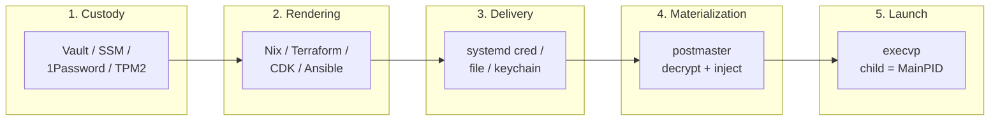

# postmaster: the secret materialization engine

Postmaster is a standalone Rust binary that does exactly one thing:
decrypt encrypted secret inputs at process launch time and inject
them into a child process, then replace its own process image with
the target binary via `execvp`.

It is not a library. It is not a plugin host. It is not a daemon
framework. It is a single binary with a fixed, local, offline
contract.

## Audience Quickstart (Plain Language)

**What this is:** the architecture of postmaster — what it does,
what it owns, and where it fits in the secret delivery pipeline.

### Who this is for

| Reader | What to take |
| -------- | ------------ |
| New user / junior engineer | "What postmaster owns" and "The secret pipeline" — understand the scope |
| Platform / SRE | "Implementation" and "Dependency policy" — what you're deploying |
| Security engineer | The entire page — this defines the security boundary |
| Integration author | "What postmaster does NOT own" and the [Launcher contract](../reference/launcher-contract.md) |
| Product / project manager | "What postmaster owns" and the pipeline diagram — the 30-second summary |

### Quick glossary

| Term | Plain meaning |
| ------ | --------------- |
| **Materialization** | Decrypting secrets and putting them where your app reads them |
| **execvp** | Unix call that replaces the current process — postmaster becomes your app |
| **ECIES** | The encryption scheme used for individual secret values |
| **Ciphertext** | Encrypted data — safe to store in git or the Nix store |
| **MainPID** | The process systemd considers "the service" — with execvp, it's your binary from instruction one |

## What postmaster owns

Postmaster owns the runtime secret path — everything that happens
between "encrypted artifact exists on disk" and "child process has
plaintext in its environment or files":

1. **Decryption.** Postmaster decrypts encrypted inputs using the
   `ecies` crate (secp256k1 + HKDF-SHA256 + AES-256-GCM). No network
   calls. No external CLIs. No shell.

2. **Injection.** Postmaster injects decrypted values into the child
   via one of three modes: environment variables (`env`), files on a
   RAM-backed filesystem (`files`), or systemd credentials
   (`credentials`).

3. **Launch.** Postmaster calls `execvp` to replace its process image
   with the target binary. The child IS `MainPID` from its first
   instruction.

4. **Cleanup.** Postmaster provides a `cleanup` subcommand that
   removes plaintext secret files from the secrets directory after
   the child exits. Wired to `ExecStopPost` in systemd; the ramdisk
   destruction handles this on macOS.

5. **Validation.** Postmaster provides `exec --check` for config shape
   validation (CI) and `setup --recheck` for runtime environment
   verification (host). Both run without decrypting secrets.

6. **Setup.** Postmaster provides an interactive `setup` command
   that creates keys directories, verifies permissions, optionally
   seeds keychain items (macOS), and validates the environment —
   idempotently.

## What postmaster does NOT own

Postmaster does NOT own anything that happens before the encrypted
artifact exists or after the child process starts:

- **Secret authoring.** Encrypting secrets is done by workstation
  tooling (dotenvx CLI, or any tool producing the same ECIES
  format). Postmaster does not encrypt.

- **Secret custody.** Where private keys live before they reach the
  host is a source/custody system concern. Vault, AWS SSM, 1Password
  — these systems hold the private key material and deliver it to a
  local terminal source. Postmaster reads it locally; it does not
  fetch it remotely.

- **Infrastructure rendering.** How the encrypted artifacts, key
  material, `exec.json`, and service wiring get onto the host is an
  automation renderer concern. Nix, Terraform, CDK, Ansible,
  SaltStack, Puppet — these tools render the deployment artifacts and
  wire the service manager. Postmaster does not deploy.

- **Service supervision.** Postmaster does not supervise the child
  process. The service manager (systemd on Linux, launchd on macOS)
  starts, monitors, and stops the service. Postmaster's job is done
  the moment `execvp` fires.

- **Child behavior.** What the child process does with its secrets —
  reading from environment variables, files, or credentials — is the
  application's concern. Postmaster guarantees the secrets are
  delivered; it does not guarantee the application handles them
  correctly.

## The secret pipeline

The full secret lifecycle is a pipeline of distinct stages, each
owned by a different system. Postmaster owns exactly one stage.

### Stage 1: Custody (source systems)

Where private key material lives before it reaches the host.

- **HashiCorp Vault** — stores private keys; a Vault Agent template
  renders a `.env.keys`-format file locally
- **AWS SSM Parameter Store** — stores private keys; cloud-init or a
  oneshot unit materializes them locally
- **1Password** — stores private keys; a bootstrap process delivers
  them to a local terminal source
- **TPM2 / host-sealed blobs** — private keys sealed to the host's
  TPM2 (or host key) via `systemd-creds encrypt --with-key=host+tpm2`,
  producing a sealed credential file that can only be decrypted on
  that specific host
- **Manual** — operator places `.env.keys` on the host directly

Postmaster does not participate in this stage. These systems deliver
key material to local terminal sources (files, credentials,
keychain). Postmaster reads from those local sources.

### Stage 2: Rendering (automation tools)

How encrypted artifacts, key material, `exec.json`, and service
wiring get onto the host.

- **Nix** — builds encrypted `.env` files into the Nix
  store, generates `exec.json`, wires systemd/launchd units
- **Terraform / OpenTofu** — renders infrastructure, deploys
  artifacts, wires service units
- **AWS CDK** — renders CloudFormation, deploys artifacts, wires
  service units
- **Ansible** — renders config, deploys artifacts, wires service
  units
- **SaltStack** — renders config, deploys artifacts, wires service
  units
- **Puppet** — renders config, deploys artifacts, wires service units

Postmaster does not participate in this stage. These tools produce
the local artifacts and wiring that postmaster consumes.

### Stage 3: Delivery (local key sources)

How key material reaches postmaster at runtime.

- **systemd credentials** (`LoadCredential=`) — PID 1 places key
  material in `$CREDENTIALS_DIRECTORY` before postmaster starts.
  This includes TPM2/host-sealed credentials via
  `LoadCredentialEncrypted=` — systemd decrypts the sealed blob
  with the host's TPM2 before placing it in the credentials directory
- **Files** — a `.env.keys`-format file on local disk (not in the
  Nix store)
- **macOS Keychain** — key material stored as generic-password items,
  read natively by postmaster via `security(1)`
- **Environment** — `DOTENV_PRIVATE_KEY*` variables in the process
  environment (set by the service manager)

Postmaster reads from these local sources. It does not fetch from
remote systems.

### Stage 4: Materialization (postmaster)

Postmaster decrypts encrypted inputs and injects them into the child
context. This is the only stage postmaster owns.

- Decrypts `.env` files via the `ecies` crate (native Rust, offline)
- Decrypts `postmaster_bundle` files via the same crypto path
- Injects via `env`, `files`, or `credentials` mode
- Zeroizes decrypted values and private keys before `execvp`
- Fails closed if any value cannot decrypt

### Stage 5: Launch (execvp)

Postmaster calls `execvp`. The process image is replaced. The child
binary IS `MainPID`. Postmaster is gone.

The service manager (systemd/launchd) supervises the child from this
point. `ExecStopPost` runs `postmaster cleanup` to remove plaintext
files after the child exits (Linux). The ramdisk is destroyed when
the launchd job stops (macOS).

## Implementation

`postmaster/` contains a dependency-lean Rust binary (edition
2024; pure-Rust crypto, no openssl; no async runtime; syscalls via
rustix's `linux_raw` backend rather than libc FFI on Linux, leaving
one `unsafe` block for the fd-ownership assertion at the systemd
socket-activation boundary; on macOS, `libc` is used for `getpeereid`
and `PT_DENY_ATTACH` hardening — each `unsafe` site carries a SAFETY
comment) that materializes decrypted secret values as systemd
`LoadCredential=` AF_UNIX sources or directly injects them via
`execvp`. systemd's documented contract for socket credential sources
is minimal — the manager connects once at process invocation and reads
until EOF, with no request metadata in-band — so the request is encoded
in the *path*: one socket per (service, key). The module generates a
single `postmaster-credd.socket` unit carrying N `ListenStream=`
entries; postmaster maps each inherited fd back to its path via
`getsockname(2)`.

On Linux, postmaster is socket-activated: the `postmaster-credd.socket`
unit owns the sockets and the daemon inherits them via `sd_listen_fds`.
On macOS it runs `--bind` (launchd has no socket-credential contract),
owning the same per-(service,key) socket paths itself; the syscall layer
is `cfg`-gated (`SO_PEERCRED`→`getpeereid`, `prctl`/`mlockall`→core-limit +
`PT_DENY_ATTACH`).

The binary has five entry points: the default daemon (`--bind`/
socket-activated `serve`), `fetch` (the darwin fetch client), `exec`
(decrypt + inject + `execvp`), `setup` (idempotent environment
verification and key provisioning), and `cleanup` (plaintext file
removal for `ExecStopPost`). Its config schema, key-source precedence,
and per-mode injection rules are the cross-binding contract at
[Launcher contract](../reference/launcher-contract.md).

## Dependency policy

Postmaster has 8 dependencies:

- `ecies` — crypto (secp256k1 + AES-256-GCM)
- `dotenvy` — `.env` file parser
- `serde` + `serde_json` — JSON config deserialization
- `base64` — ciphertext decoding
- `hex` — key parsing
- `rustix` — syscalls (no libc FFI on Linux)
- `libc` — macOS only (for `getpeereid` and `PT_DENY_ATTACH`)
- `zeroize` — secret memory wiping

No CLI parsing library (clap, etc.). No async runtime. No OpenSSL.
No network client. No plugin system. The dependency set is
intentionally minimal: smaller binary, smaller attack surface,
faster startup, fewer supply-chain risks.

New dependencies are rejected unless they are strictly necessary
for the core decrypt-inject-execvp path and cannot be implemented in
a few lines of stdlib + rustix.
