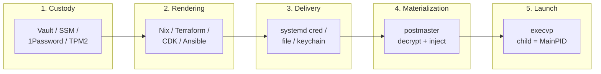

# postmaster: the secret materialization engine

Postmaster is a standalone Rust binary that decrypts secret inputs
at process launch, injects them into the child process, and replaces
its own process image with the target binary via `execvp`.

It ships as a standalone binary with a local, offline contract. Decryption
and projection are implemented in the repository's Rust library crate.

## Audience quickstart

This page describes Postmaster's runtime responsibilities and the deployment
stages around it.

### Who this is for

| Reader | What to take |
| -------- | ------------ |
| New user / junior engineer | "What postmaster owns" and "The secret pipeline" — understand the scope |
| Platform / SRE | "Implementation" and "Dependency policy" — what you're deploying |
| Security engineer | The entire page — this defines the security boundary |
| Integration author | "What postmaster does NOT own" and the [Launcher contract](../reference/launcher-contract.md) |
| Product / project manager | "What postmaster owns" and the pipeline diagram |

### Quick glossary

| Term | Plain meaning |
| ------ | --------------- |
| **Materialization** | Decrypting secrets and putting them where your app reads them |
| **execvp** | Unix call that replaces the current process — postmaster becomes your app |
| **ECIES** | The encryption scheme used for individual secret values |
| **Ciphertext** | Encrypted data — safe to store in git or the Nix store |
| **MainPID** | The process systemd considers "the service" — with execvp, it's your binary from instruction one |

## What postmaster owns

Postmaster owns the runtime secret path — everything that happens
between "encrypted artifact exists on disk" and "child process has
plaintext in its environment or files":

1. **Decryption.** Postmaster decrypts encrypted inputs using the
   `ecies` crate (secp256k1 + HKDF-SHA256 + AES-256-GCM). No network
   calls. No external CLIs. No shell.

2. **Injection.** Postmaster injects decrypted values into the child
   via one of three modes: environment variables (`env`), files on a
   RAM-backed filesystem (`files`), or systemd credentials
   (`credentials`).

3. **Launch.** Postmaster calls `execvp` to replace its process image
   with the target binary. The child IS `MainPID` from its first
   instruction.

4. **Cleanup.** Postmaster provides a `cleanup` subcommand that
   removes plaintext secret files from the secrets directory after
   the child exits. Wired to `ExecStopPost` in systemd; the ramdisk
   destruction handles this on macOS.

5. **Validation.** Postmaster provides `exec --check` for config shape
   validation (CI) and `setup --recheck` for runtime environment
   verification (host). Both run without decrypting secrets.

6. **Setup.** Postmaster provides an interactive `setup` command
   that creates keys directories, verifies permissions, optionally
   seeds keychain items (macOS), and validates the environment —
   idempotently.

## What Postmaster does not own

Deployment tooling owns authoring, custody, and service-manager policy:

- **Secret authoring.** Encrypting secrets is done by workstation
  tooling (dotenvx CLI, or any tool producing the same ECIES
  format). Postmaster does not encrypt.

- **Secret custody.** Where private keys live before they reach the
  host is a source/custody system concern. Vault, AWS SSM, 1Password
  — these systems hold the private key material and deliver it to a
  local terminal source. Postmaster reads it locally; it does not
  fetch it remotely.

- **Infrastructure rendering.** How the encrypted artifacts, key
  material, `exec.json`, and service wiring get onto the host is an
  automation renderer concern. Nix, Terraform, CDK, Ansible,
  SaltStack, Puppet — these tools render the deployment artifacts and
  wire the service manager. Postmaster does not deploy.

- **Service supervision policy.** Postmaster owns no lifecycle policy
  — no restarts, no health checks. The service manager (systemd on
  Linux, launchd on macOS) starts, monitors, and stops the service.
  Postmaster runs a sibling monitor alongside
  the exec'd service: it forwards stop signals, escalates to SIGKILL
  after a bounded grace, and removes plaintext secret files on every
  death path while the monitor survives. Integration cleanup and storage
  teardown provide backstops if it doesn't.

- **Child behavior.** What the child process does with its secrets —
  reading from environment variables, files, or credentials — is the
  application's concern. Postmaster guarantees the secrets are
  delivered; it does not guarantee the application handles them
  correctly.

## The secret pipeline

The secret lifecycle has separate custody, rendering, delivery,
materialization, and launch responsibilities. Postmaster handles
materialization and the process handoff.

### Stage 1: Custody (source systems)

Where private key material lives before it reaches the host.

- **HashiCorp Vault** — stores private keys; a Vault Agent template
  renders a `.env.keys`-format file locally
- **AWS SSM Parameter Store** — stores private keys; cloud-init or a
  oneshot unit materializes them locally
- **1Password** — stores private keys; a bootstrap process delivers
  them to a local terminal source
- **TPM2 / host-sealed blobs** — private keys sealed to the host's
  TPM2 (or host key) via `systemd-creds encrypt --with-key=host+tpm2`,
  producing a sealed credential file that can only be decrypted on
  that specific host
- **Manual** — operator places `.env.keys` on the host directly

Postmaster does not participate in this stage. These systems deliver
key material to local terminal sources (files, credentials,
keychain). Postmaster reads from those local sources.

### Stage 2: Rendering (automation tools)

How encrypted artifacts, key material, `exec.json`, and service
wiring get onto the host.

- **Nix** — builds encrypted `.env` files into the Nix
  store, generates `exec.json`, wires systemd/launchd units
- **Terraform / OpenTofu** — renders infrastructure, deploys
  artifacts, wires service units
- **AWS CDK** — renders CloudFormation, deploys artifacts, wires
  service units
- **Ansible** — renders config, deploys artifacts, wires service
  units
- **SaltStack** — renders config, deploys artifacts, wires service
  units
- **Puppet** — renders config, deploys artifacts, wires service units

Postmaster does not participate in this stage. These tools produce
the local artifacts and wiring that postmaster consumes.

### Stage 3: Delivery (local key sources)

How key material reaches postmaster at runtime.

- **systemd credentials** (`LoadCredential=`) — PID 1 places key
  material in `$CREDENTIALS_DIRECTORY` before postmaster starts.
  This includes TPM2/host-sealed credentials via
  `LoadCredentialEncrypted=` — systemd decrypts the sealed blob
  with the host's TPM2 before placing it in the credentials directory
- **Files** — a `.env.keys`-format file on local disk (not in the
  Nix store)
- **macOS Keychain** — key material stored as generic-password items,
  read natively by postmaster via the Security.framework API
- **Environment** — `DOTENV_PRIVATE_KEY*` variables in the process
  environment (set by the service manager)

Postmaster reads from these local sources. It does not fetch from
remote systems.

### Stage 4: Materialization (postmaster)

Postmaster decrypts local inputs and projects the resulting values into the
application's environment or files.

- Decrypts `.env` files via the `ecies` crate (native Rust, offline)
- Decrypts `postmaster_bundle` entries with name-bound AES-GCM AAD
- Injects via `env`, `files`, or `credentials` mode
- Zeroizes its key ring and resolved buffers before `execvp`
- Rejects decryption failures by default; `strict: false` permits skipped
  dotenv values, while bundle authentication remains mandatory

### Stage 5: Launch (execvp)

Postmaster forks a **sibling monitor** and then calls `execvp` in the
parent. The service binary remains `MainPID`; the launcher's process image
is gone.

The fork-child becomes the monitor. It scrubs its projected environment
pairs, keeps the termination signals blocked for life, and
supervises its parent — forwards stop signals with a 250 ms grace
before SIGKILL escalation, and removes the plaintext secret files on
every service-death path (natural exit, `kill -9`, crash), then exits.
One monitor process runs for the service's lifetime. It watches liveness
with pidfd and `poll` on Linux, or kqueue `NOTE_EXIT` on macOS.

The monitor retains the original process environment, which can contain
private keys supplied through environment variables. Use a non-environment
key source to avoid this exposure. The credential daemon is a separate,
long-lived process that retains its key ring for requests.

The service manager (systemd/launchd) supervises the child from this
point. `ExecStopPost` runs `postmaster cleanup` to remove plaintext
files after the child exits (Linux) — now a backstop behind the
monitor. The ramdisk is destroyed when the launchd job stops (macOS).

## Implementation

Postmaster uses Rust edition 2024, RustCrypto, and no async runtime or OpenSSL.
Linux uses rustix's `linux_raw` backend, with a libc call for `fork`.
macOS uses libc for peer checks, signal handling, kqueue, and anti-debug
hardening. Each unsafe site has a SAFETY comment and an entry in the
[unsafe-code registry](../unsafe-code/index.md).

The binary serves decrypted values as systemd `LoadCredential=` AF_UNIX
sources or projects them before `execvp`. systemd's contract for socket sources
is minimal — the manager connects once at process invocation and reads
until EOF, with no request metadata in-band — so the request is encoded
in the *path*: one socket per (service, key). A binding can generate a
single `postmaster-credd.socket` unit carrying N `ListenStream=`
entries; postmaster maps each inherited fd back to its path via
`getsockname(2)`.

On Linux, postmaster is socket-activated: the `postmaster-credd.socket`
unit owns the sockets and the daemon inherits them via `sd_listen_fds`.
On macOS it runs `--bind` (launchd has no socket-credential contract),
owning the same per-(service,key) socket paths itself; the syscall layer
is `cfg`-gated (`SO_PEERCRED`→`getpeereid`, `prctl`/`mlockall`→core-limit +
`PT_DENY_ATTACH`).

The binary has five entry points: the default daemon (`--bind`/
socket-activated `serve`), `fetch` (the local socket client), `exec`
(decrypt + inject + `execvp`), `setup` (idempotent environment
verification and key provisioning), and `cleanup` (plaintext file
removal for `ExecStopPost`). Its config schema, key-source precedence,
and per-mode injection rules are the cross-binding contract at
[Launcher contract](../reference/launcher-contract.md).

## Dependency policy

Source builds require Rust 1.99.1 or newer. The flake exports packages and
an overlay, not NixOS or nix-darwin service modules. Deployment integrations
own the service units, RAM-backed storage, and hardening described above.

Postmaster has 11 direct dependencies (9 portable, 2 platform-gated):

- `ecies` — crypto (secp256k1 + AES-256-GCM)
- `aes-gcm` — bundle-envelope authentication with entry-name AAD
- `dotenvy` — `.env` file parser
- `serde` + `serde_json` — JSON config deserialization
- `base64` — ciphertext decoding
- `hex` — key parsing
- `rustix` — syscalls (raw syscalls via `linux_raw` on Linux, incl. the
  monitor's pidfd/poll and the experimental `runtime` signal-mask API;
  the only libc FFI on Linux is `fork(2)` — see the unsafe registry)
- `libc` — macOS (getpeereid, `PT_DENY_ATTACH`, the monitor's
  kqueue/signal ops) plus Linux `fork(2)` only (rustix has no fork
  wrapper)
- `security-framework` — macOS only (Security.framework keychain reads)
- `zeroize` — secret memory wiping

Bundle envelopes use Postmaster's AAD decoder with the released `ecies`
curve/HKDF helpers and RustCrypto AES-GCM. This preserves existing ciphertext
compatibility without an upstream AAD API dependency.

The CLI parser uses the standard library. There is no async runtime, OpenSSL
dependency, remote secret-store client, or plugin system. Each dependency
must justify its role in the runtime path.

New dependencies are rejected unless they are strictly necessary
for the core decrypt-inject-execvp path and cannot be implemented in
a few lines of stdlib + rustix.
