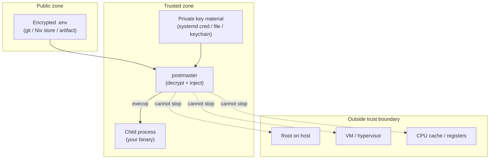

# Threat model

## Audience Quickstart (Plain Language)

**What this is:** what postmaster protects, what it cannot prevent,
and why it's built this way. This is the security reference.

### Who this is for

| Reader | What to take |
| -------- | ------------ |
| Security engineer | The entire page — every claim is about the security boundary |
| Platform / SRE | "Swap and core dumps" and "Hardening inheritance" — what to configure |
| Integration author | "Why a native launcher" — understand the design constraints |
| New user | "Secrets at rest" and "Fail-closed" — the 30-second security summary |
| Product / project manager | The residuals table — what postmaster does NOT protect against |

### Quick glossary

| Term | Plain meaning |
| ------ | --------------- |
| **execvp** | Replaces the current process — no parent holds secrets after launch |
| **Fail-closed** | If anything fails, the service does NOT start — no partial secrets |
| **Zeroize** | Overwrite secret memory with zeros before it's freed |
| **mlockall** | Pin memory in RAM so the kernel can't swap it to disk |
| **TOCTOU** | Time-of-check to time-of-use — a race between verifying and using a file |
| **Residual** | A risk that postmaster cannot fully eliminate |
| **Non-goal** | Something postmaster deliberately does not attempt to mitigate |

### Security posture at a glance

| Category | Status |
| -------- | ------ |
| Secrets at rest (ciphertext in git/Nix store) | Safe — ciphertext is public |
| Plaintext on persistent disk | Prevented — only RAM-backed filesystems |
| Plaintext in swap | Mitigated — mlockall + MemorySwapMax=0 |
| Core dumps | Mitigated — PR_SET_DUMPABLE=0, RLIMIT_CORE=0 |
| Shell injection | Prevented — no shell anywhere in the path |
| Symlink attacks on key files | Prevented — O_NOFOLLOW + fstat |
| Same-UID env var exposure (env mode) | Residual — use files or credentials mode |
| Root on the host | Residual — root is always game over |
| VM/hypervisor inspection | Residual — outside the trust boundary |
| CPU cache/register residue | Non-goal — no mitigation available |

## Why a native launcher, not a shell wrapper

Postmaster is a native Rust binary, not a shell wrapper around an
external CLI. This decision is driven by three security properties that
a shell-based approach cannot provide.

### Process identity: execvp, not spawn

When postmaster launches your service, it uses `execvp` — the system
call that replaces the current process image with the target binary.
The process ID (PID) does not change. The service binary is `MainPID`
from its first instruction.

A shell wrapper or Node.js parent process would `spawn` a child
instead. The parent stays alive as `MainPID`, which breaks:

- **systemd readiness notifications** (`Type=notify`, `sd_notify`):
  systemd expects `MainPID` to send `READY=1`. A parent process that
  spawns the real service means the wrong process is notifying.
- **Cgroup memory accounting**: the parent's memory (including private
  key material) is counted against the service unit's cgroup.
- **Secret lifetime**: the parent process holds private keys and
  decrypted values in its heap for the entire lifetime of the service.
  With `execvp`, postmaster's process image is replaced — all heap
  memory is released and the kernel zeroes the pages before reuse.

### No shell interpolation

A shell-based launcher would use `eval` or source-based injection to
set environment variables. That leaves `$(…)` and backticks live
inside double quotes. Combined with a public key embedded in the
repository (which lets any repo writer add or replace encrypted
values), this would be remote code execution at service start for
anyone who can commit to the repo.

Postmaster never shells out or evals. Decrypted values move directly
into the child's environment array or a file write. No shell sits
between decryption and injection to reinterpret the values.

### Offline decryption

Postmaster's decryption uses the `ecies` library — a native Rust
implementation of the same crypto path as dotenvx. It makes no network
calls of any kind. There is no update check, no telemetry, no CLI
settings directory to manage.

This is an invariant of the secret path: postmaster must not become an
AWS SSM client, a Vault client, or a general secret-store plugin host.
Centralized secret stores (Vault, AWS SSM, 1Password, etc.) are
source/custody systems that deliver key material to postmaster through
local terminal sources such as systemd credentials, out-of-store
files, macOS keychain items, or a deliberately managed process
environment. Postmaster materializes secrets locally; it does not
fetch them remotely.

## What postmaster protects

### Trust boundary overview

### Secrets at rest

Encrypted `.env` files and `postmaster_bundle` files are safe to store
in git, the Nix store, binary caches, and deploy artifacts. The
ciphertext is public — the matching private key is the real secret.
Only someone with the private key can decrypt the values.

A teammate who has repository access (and thus the public key) can add
or replace encrypted secrets, but cannot read existing ones.

### Plaintext never on persistent disk

Decrypted values exist only in:

- **Process memory** (anonymous heap, zeroized after use)
- **RAM-backed filesystems** (Linux tmpfs, macOS ramdisk — destroyed
  when the service unit stops)

They are never written to a file on persistent disk. The tmpfs is
namespace-private (invisible outside the unit's mount namespace on
Linux) and unswappable (via `mlockall` on Linux and the service
manager's cgroup-level `MemorySwapMax=0` setting).

### Fail-closed by default

If any value fails to decrypt (wrong key, corrupted ciphertext, stale
key file), the entire launch aborts before the child process starts.
Nothing partial is injected. This is controlled by the `strict`
setting, which defaults to `true`.

### Symlink attacks on key files and secret paths

Postmaster rejects symlinks at every point where secret material is
read or written:

- **Key files** are opened with `O_NOFOLLOW` — a symlinked `.env.keys`
  file is rejected at the kernel level. The file descriptor is then
  `fstat`-ed to verify that permissions are `0o077` (no group or world
  access) and that the owner matches the current effective user ID.
  This fd-based approach eliminates the TOCTOU window between open
  and permission check.
- **Credential source paths** are checked with `symlink_metadata`
  before loading, rejecting symlinks at the path level. The
  `O_NOFOLLOW` open in `KeyRing::load` provides defense-in-depth at
  the fd level.
- **Secret files** are written with `O_NOFOLLOW | O_CREAT | O_TRUNC`
  — a symlink planted at the target path is rejected, not followed.
- **Secrets directory** is checked with `symlink_metadata` even on
  Linux where `verify_ramdisk` is not used, rejecting a symlinked
  `secrets_dir` that could redirect plaintext to persistent disk.
- **Socket permissions** are set via `fchmod` on the file descriptor,
  not `set_permissions` on the path, eliminating the TOCTOU window
  between `bind` and `chmod`.

### External binary verification

Keychain access on macOS uses the Security.framework API in-process —
no external binary is invoked for it. The external binaries postmaster
does invoke in secret-adjacent paths (`/usr/bin/id`, `/sbin/mount`,
`/usr/bin/hdiutil`) are verified before use:

- **macOS:** `codesign -v` verifies a valid Apple code signature
  (defense-in-depth; the binaries are also SIP-protected).
- **Linux:** verified as regular files owned by root (uid 0) and not
  world-writable.

### Input validation

Postmaster validates all externally-authored input before it enters
the secret path:

- **NUL byte rejection:** Environment variable values containing NUL
  bytes are rejected in `env` mode (NUL cannot appear in a POSIX
  environment variable) and in `passthrough` values in `files` mode.
  Credential source names are checked for NUL bytes before any path
  operation.
- **Path traversal rejection:** Credential source names must be a
  single relative path component — `.`, `..`, absolute paths, and
  slash-containing paths are rejected.
- **Identifier validation:** All key names must match
  `[A-Za-z_][A-Za-z0-9_]*` — this is enforced before any value from
  that file is used, since a key name becomes a shell-visible env-var
  name or a filename component.
- **No shell expansion:** Postmaster performs no `${VAR}` or `$(…)`
  expansion anywhere in the decrypt-and-inject path. Values are
  opaque bytes end to end. A repo contributor who commits
  `KEY=$(cmd)` gets the literal string, never a command execution at
  service start.

### Key freshness verification

Postmaster provides `--verify-keys` on `exec` to detect stale keys
from a previous rotation cycle. After loading and decrypting, if any
value was skipped because the key ring could not decrypt it, the exec
aborts with a clear error naming the key. This catches the
`strict: false` case where stale keys would otherwise silently skip
undecryptable values and launch the child with a partial or empty
secret set. Bundle files need no such check: bundle resolution is
all-or-nothing, so a stale bundle key already aborts the exec
regardless of `strict`.

## Residuals: what postmaster cannot fully prevent

### Environment variables are visible to same-UID processes (env mode)

In `env` mode, decrypted values are injected as environment variables.
Any process running as the same user can read them via `/proc/PID/environ`,
`ps e`, or environment dump tools. This is a fundamental Unix property —
environment variables are not secret from same-UID processes.

Mitigations: `DynamicUser` (a fresh UID per service), `ProtectProc`
hardening (hides other processes' `/proc` entries), and ultimately
switching to `files` mode (where values are written to files, not
environment variables).

On the BEAM (Erlang/Elixir), `os:getenv/1` is reachable from any code
in the node, including a remote shell. Files mode with read-once-at-boot
into guarded state (and `process_flag(sensitive, true)` on the holder)
is strictly better than leaving secrets in the environment for the
node's lifetime.

### Root on the host

A process running as root can read any other process's memory via
`/proc/PID/mem` or `ptrace`. This is the Unix trust boundary — root is
always game over. Postmaster's `PR_SET_DUMPABLE=0` and `PT_DENY_ATTACH`
prevent non-privileged peers from attaching, but cannot stop root.

### Rotation timing oracle

When multiple private keys are configured for one variable (the
comma-separated rotation convention), decryption tries each candidate in
order and stops at the first that works. A local observer measuring
launch or fetch latency can infer which candidate matched — i.e., the
rotation position of the current key. Accepted (audit 2026-08-02 A14):
the observer learns only the rotation index, not key material, and
already needs same-host access; equalizing the timing would require
attempting every candidate on every decryption for no meaningful gain.

### Env-file content is trusted input (no variable-name denylist)

Postmaster injects what the configured env files and bundles say,
including plaintext passthrough entries. There is no denylist of
environment variable names (audit 2026-08-02 A18): names like
`LD_PRELOAD` or `PATH` are honored, because real deployments
legitimately set variables of this family (`LD_LIBRARY_PATH` is common).
The protection boundary is artifact authorship: anyone who can write the
env file (or produce valid ciphertext for it) already controls what the
child process receives. Treat plaintext passthrough entries in
world-readable artifacts as code-level intent, and keep artifact write
access tight. If a denylist is ever wanted, it belongs in config
validation as an explicit opt-in policy, not a silent default.

### Swap and core dumps

Swap and core dumps are the two ways plaintext can leak from memory to
persistent disk.

**Core dumps** are disabled at both the process level
(`PR_SET_DUMPABLE=0` on Linux, `RLIMIT_CORE=0` on macOS) and the unit
level (`LimitCORE=0`, `CoredumpFilter=0` in the Nix module). For
host-wide coverage, set
`systemd.coredump.extraConfig = "Storage=none"`.

**Swap** is addressed on two layers:

- Per-unit: the service manager (systemd) can set `MemorySwapMax=0` on
  the unit, preventing the kernel from swapping the unit's pages.
  Postmaster also calls `mlockall(MCL_CURRENT | MCL_FUTURE)` on Linux
  (best-effort, may fail under `RLIMIT_MEMLOCK`). On macOS,
  `mlockall(2)` does not exist, but macOS encrypts swap by default, so
  swapped pages are ciphertext at rest.
- Host-wide: encrypted swap or zram keeps all swap off persistent disk.
  On NixOS, this is a one-liner:
  [`swapDevices.*.randomEncryption`](https://search.nixos.org/options?show=swapDevices.*.randomEncryption.enable)
  for dm-crypt with an ephemeral key, or
  [`zramSwap.enable`](https://search.nixos.org/options?show=zramSwap.enable)
  to keep swap in compressed RAM (background:
  [Arch wiki, dm-crypt swap encryption](https://wiki.archlinux.org/title/Dm-crypt/Swap_encryption)).

### Hardening inheritance across execvp

Postmaster calls `harden_process()` at startup, which sets process-level
hardening (`PR_SET_DUMPABLE=0`, `mlockall`, `RLIMIT_CORE=0`). After
`execvp`, the child process gets a fresh address space. Some settings
survive `execvp`, some do not:

- **`RLIMIT_CORE`**: preserved across `execve` (kernel guarantee). The
  child inherits `LimitCORE=0` from the systemd unit. Core dumps stay
  disabled.
- **`PR_SET_DUMPABLE`**: preserved across `execve` for non-setuid
  binaries. The child inherits non-dumpable status unless it is a
  setuid/setgid/capability-bearing binary (which would be unusual for
  a service).
- **`MemorySwapMax=0`**: cgroup-level, not process-level. The child
  stays in the same cgroup, so the swap limit applies to the child's
  pages too. This is the primary swap protection for the child. The
  Nix module sets this via `preventSwap = true` by default.
- **`mlockall`**: does NOT survive `execvp` — the child's fresh address
  space is not pinned in RAM. This gap is covered by the cgroup-level
  `MemorySwapMax=0`.

## Memory residency

Plaintext secrets exist in process memory between decryption and
consumption. This section documents where plaintext lives, what
postmaster mitigates, what remains as a residual, and what is
explicitly a non-goal.

### Anonymous memory (heap, stack) — Mitigated

Postmaster's decrypted values, key material, and resolved environment
pairs all live in anonymous memory — heap allocations wrapped in
`Zeroizing<Vec<u8>>` that zero the buffer on drop. The child process
receives plaintext via its environment array (env mode) or reads it
from files on a tmpfs/ramdisk (files/credentials mode).

**Paging/swap:** Anonymous pages can be swapped out by the kernel.
Postmaster mitigates this on Linux with `mlockall(MCL_CURRENT |
MCL_FUTURE)` (best-effort, may fail under `RLIMIT_MEMLOCK`) and the
service manager's cgroup knob `MemorySwapMax=0` (wired by `preventSwap`
in the Nix module). On macOS, `mlockall(2)` does not exist, but macOS
encrypts swap by default, so swapped pages are ciphertext at rest.
Host-wide encrypted swap or zram on Linux provides the same guarantee
without per-unit configuration.

**Core dumps:** Disabled at the process level (`PR_SET_DUMPABLE=0` on
Linux, `RLIMIT_CORE=0` on macOS) and at the unit level
(`LimitCORE=0`, `CoredumpFilter=0` in the Nix module). Host-wide
`systemd.coredump.extraConfig = "Storage=none"` is a belt for all
units.

**Pre-execvp zeroization:** Private keys (the `KeyRing`) are zeroized
when `decrypt()` returns and the `ring` local goes out of scope —
each `Zeroizing<[u8; 32]>` wipes its 32 bytes on drop. Decrypted
values (`Resolved`, a `Vec<(String, Zeroizing<Vec<u8>>)>`) are
explicitly `drop`ped immediately after they are consumed, before
`execvp` is called. In env mode, `resolved` is dropped after
`env_pairs` extracts the `OsString` pairs the kernel needs. In
files mode, `resolved` is dropped after the secret files are written.
Only the `extra` vector (env array for env mode, file paths for files
mode) survives to `execvp` — and in files mode, `extra` contains only
paths, not plaintext.

### Post-execvp heap lifetime — Residual (mitigated as far as possible)

After `execvp`, the process image is replaced. The `Zeroizing` drop
handlers for the `resolved` values have already fired (via explicit
`drop`), but the `extra` vector (env mode) holds plaintext as
`OsString` pairs that the kernel needs to build the child's environ.
The kernel copies these into the new process's environment and the
old process's heap pages are released. The kernel zeroes anonymous
pages before reusing them, so the plaintext exists only in freed
pages until the kernel reclaims them — a transient window, not a
persistent risk.

No further mitigation is possible: the kernel needs the env array
to be intact at the moment of `execvp`, and `execvp` replaces the
process image without running destructors. Fork+wait would keep
secrets in a long-lived parent heap (strictly worse) and was rejected.

### Monitor inherited heap — Mitigated

The sibling monitor is forked after zeroization, so the key ring and
the `Zeroizing` resolved values are already wiped in the copy it
inherits. One plaintext-bearing structure does cross the fork: the
`extra` env array (plaintext values in env mode and in files-mode
passthrough). The monitor scrubs its copy **first**, before the
supervision loop starts: each `OsString` is consumed into its existing
buffer (no copy) and wiped in place with `zeroize` — free() alone
would leave the bytes in the monitor's mapped pages for its whole life,
and the monitor never allocates again, so they would never even be
reused. The parent's copy dies with `execvp` (image replacement). What
the monitor keeps beyond the scrub is non-secret metadata only: the
pinned secrets-dir fd and entry names (already visible in the
directory listing).

### File-backed memory (page cache) — Mitigated by design

Postmaster does not `mmap` secret files. Secret files on Linux tmpfs
and macOS ramdisk are kernel-resident RAM — they are never on
persistent disk and never enter the page cache for a backing file.
The `.env` and `.env.keys` source files are read via `dotenvy`'s
`from_read_iter` which uses `read(2)`, not `mmap(2)` — their contents
enter anonymous memory, not file-backed pages.

The distinction matters: file-backed pages (e.g., a secret stored in a
regular file on an ext4 volume) persist in the kernel page cache after
the file is closed and the process exits. Postmaster avoids this by
writing secrets only to tmpfs/ramdisk (RAM-backed, no page cache for a
backing file) and by using `read(2)` for source files (anonymous
memory, not mapped).

### Container swap enforcement — Mitigated

`MemorySwapMax=0` can be wired by the service manager (systemd) or the
Nix module via `preventSwap`. This enforces the cgroup's swap limit —
the kernel will not swap the unit's pages even under host memory
pressure. The residual is only if the host kernel itself is
compromised, which falls under "root on the host is always game over."
Host-wide encrypted swap is recommended as defense-in-depth for the
entire host, not just postmaster's cgroup.

### VM and hypervisor inspection — Residual (no mitigation available)

A hypervisor can inspect guest memory, take snapshots, or
live-migrate VMs to other hosts. Postmaster's `mlockall` and
`MemorySwapMax=0` operate inside the guest kernel; the hypervisor is
outside the trust boundary. The only defense is confidential computing
hardware (AMD SEV-SNP, Intel TDX, AWS Nitro Enclaves), which is
outside postmaster's scope and dependency set.

### CPU registers and cache — Non-goal (no mitigation available)

Plaintext secrets pass through CPU registers and L1/L2/L3 cache
during decryption and injection. Postmaster does not attempt to flush
cache lines or zero registers after use. This is a non-goal:
mitigating cache-line side channels and register residue requires
constant-time crypto implementations and hardware support (e.g., TSX
memory scrubbing, `wbinvd` instruction) that are outside postmaster's
scope. The crypto library (`ecies`) uses `secp256k1` and `AES-256-GCM`
primitives that are not guaranteed constant-time on all targets; this
is a property of the crypto library, not postmaster.

### Privileged ptrace — Residual (no mitigation available)

`PR_SET_DUMPABLE=0` (Linux) and `PT_DENY_ATTACH` (macOS release builds)
prevent non-privileged peers from attaching. A privileged process
(root, or a process with `CAP_SYS_PTRACE`) can still read process
memory — this is unavoidable and the same trust boundary as "root on
the host is always game over." No software mitigation exists for
privileged memory inspection within the same kernel.

### Plaintext file persistence window (files mode) — Mitigated

Secret files written to the tmpfs/ramdisk are removed by the **sibling
launch monitor** (design 2026-08-05), by `postmaster cleanup --config
<exec.json>` wired to `ExecStopPost` in the systemd Nix module, and by
ramdisk destruction when the `postmaster-ramdisk` launchd job stops. The
`prune_stale` function also removes stale files from prior launches
before writing new ones.

A `TerminationGuard` blocks SIGTERM/SIGINT/SIGHUP/SIGQUIT across the
write window on both platforms, so a signal landing mid-write cannot
strand partial plaintext (audit 2026-08-02 A11). At the end of the
window — after zeroization, before `execvp` — the launcher forks. The
parent restores its pre-guard mask and execs the service (MainPID
unchanged); the fork-child is the **sibling monitor**: it keeps the
four termination signals blocked for life and owns stop semantics.

*Monitor model (2026-08-05):* the monitor consumes stop signals
synchronously (no handlers anywhere — the sigaction flag-handler and
second pre-exec gate were retired with this design), forwards them to
the service, and escalates to SIGKILL after a **250 ms grace** — a
single global constant, deliberately not configurable (per-service
erosion of a security policy is unacceptable; the per-unit knob is the
manager's own stop timeout). Cleanup runs on **every** death path:
forwarded stops, natural exit, `kill -9`, crashes. Liveness uses a
pidfd + `poll` on Linux and kqueue `NOTE_EXIT` on macOS — both fire at
exit (zombie- and PID-reuse-proof); `kill(pid, 0)` polling is fallback
only. On systemd the monitor receives its own copy of cgroup-wide stop
signals, so it never depends on a signal the launcher already consumed.
On launchd, signals go to the job's main process only, so the monitor
is primarily a cleanup-watcher there — the macOS stop-path exposure
(plus the bounded PID-reuse window of its `kill(2)` forwarding, Darwin
having no pidfd) remains bounded by the ramdisk teardown at job stop,
the strongest backstop in the system. A monitor that dies before the
service leaves the pre-existing backstops (`ExecStopPost`, teardown,
`prune_stale`) — the same floor as before the monitor existed.

### Shared `secrets_dir` (multi-tenant misuse) — Documented contract

`secrets_dir` is single-tenant per service: `prune_stale` and the
monitor's cleanup delete files based on one service's key set, so two
services sharing one directory lets one service's lifecycle delete the
other's live files. The impact is availability, not confidentiality —
no plaintext crosses services. The generated Nix modules comply by
construction (Linux: each unit mounts a namespace-private tmpfs at the
path; darwin: per-service subdirectory under the shared ramdisk), so
this binds hand-written configs only: one `secrets_dir` per service.
Runtime enforcement via a service-identity sentinel is a
considered-and-deferred hardening for the broker era, when multi-tenant
topologies become real by design.

### Ramdisk mount verification (macOS) — Mitigated

`verify_ramdisk` verifies the mount is RAM-backed by parsing
`hdiutil info` for the device's `image-path` starting with `ram://`.
Fails closed if the device isn't found or isn't RAM-backed, preventing
plaintext from being written to a file-backed HFS image masquerading
as the ramdisk.

### fd closure before execvp — Mitigated

`OFlags::CLOEXEC` is set on every file descriptor postmaster opens (all
`rustix::fs::open`/`openat` sites) — the kernel automatically closes
these on execvp, preventing the child from inheriting postmaster's open
file descriptors. Third-party parsers never open their own fds in
postmaster's paths: dotenvy is only invoked as `dotenvy::from_read_iter`
on fds postmaster itself opened (`O_NOFOLLOW | CLOEXEC`). Postmaster's
own fds are fully covered.

### Secrets directory path exposure — Mitigated

The child receives secrets via `$KEY_FILE` pointers (Docker secrets
convention, systemd credentials convention, 12-factor `_FILE`
pattern). The secrets directory path is not separately exported as
an environment variable. `CREDENTIALS_DIRECTORY` is exported in
credentials mode because it is a systemd standard that the child
uses to locate credential files.
