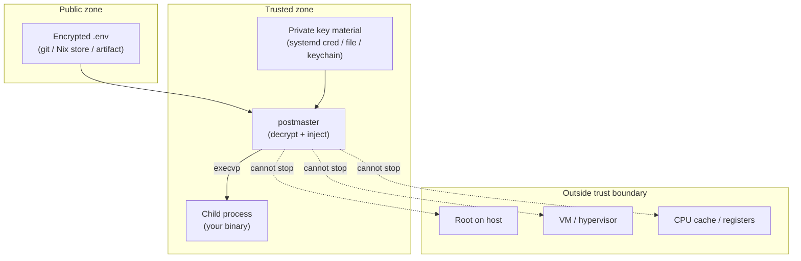

# Threat model

## Audience quickstart

This reference defines Postmaster's trust boundary, deployment requirements,
and remaining exposure.

### Who this is for

| Reader | What to take |
| -------- | ------------ |
| Security engineer | The entire page — every claim is about the security boundary |
| Platform / SRE | "Swap and core dumps" and "Hardening inheritance" — what to configure |
| Integration author | "Why a native launcher" — understand the design constraints |
| New user | "Secrets at rest" and "Fail-closed" |
| Product / project manager | The residuals table |

### Quick glossary

| Term | Plain meaning |
| ------ | --------------- |
| **execvp** | Replaces the launcher with the target binary while keeping its PID. The sibling monitor is a separate process. |
| **Fail-closed** | A failed required check prevents launch; dotenv decryption is strict by default |
| **Zeroize** | Overwrite secret memory with zeros before it's freed |
| **mlockall** | Pin memory in RAM so the kernel can't swap it to disk |
| **TOCTOU** | Time-of-check to time-of-use — a race between verifying and using a file |
| **Residual** | A risk that postmaster cannot fully eliminate |
| **Non-goal** | Something postmaster deliberately does not attempt to mitigate |

### Security posture at a glance

| Category | Status |
| -------- | ------ |
| Secrets at rest (ciphertext in git/Nix store) | Safe — ciphertext is public |
| Plaintext on persistent disk | Avoided when the deployment supplies RAM-backed secret storage |
| Plaintext in swap | Mitigated — mlockall + MemorySwapMax=0 |
| Core dumps | Mitigated — PR_SET_DUMPABLE=0, RLIMIT_CORE=0 |
| Shell injection through secret values | Values are passed without shell evaluation |
| Symlink attacks on key files | Prevented — O_NOFOLLOW + fstat |
| Same-UID env var exposure (env mode) | Residual — use files or credentials mode |
| Root on the host | Outside the trust boundary; privileged processes can inspect memory |
| VM/hypervisor inspection | Residual — outside the trust boundary |
| CPU cache/register residue | Outside Postmaster's memory-wiping guarantees |

## Why a native launcher, not a shell wrapper

Postmaster decrypts in Rust and replaces the launcher with the service.
The relevant properties are process identity, value handling, and local
decryption.

### Process identity: execvp, not spawn

When postmaster launches your service, it uses `execvp` — the system
call that replaces the current process image with the target binary.
The process ID (PID) does not change. The service binary is `MainPID`
from its first instruction.

A wrapper that spawns the service and remains alive keeps another process
in the service unit. That affects:

- **systemd readiness notifications** (`Type=notify`, `sd_notify`):
  notifications must come from the process the unit is configured to accept.
  Keeping the wrapper as `MainPID` can leave the service outside that rule.
- **Cgroup memory accounting**: the parent's memory (including private
  key material) is counted against the service unit's cgroup.
- **Secret lifetime**: the parent process holds private keys and
  decrypted values in its heap for the entire lifetime of the service.
  With `execvp`, postmaster's process image is replaced — all heap
  memory is released and the kernel zeroes the pages before reuse.

### No shell interpolation

A launcher that evaluates secret values through a shell can execute `$(…)`
or backticks inside those values. Anyone with the public key can encrypt a
replacement value, so artifact write access combined with shell evaluation
can become command execution at service start.

Postmaster doesn't evaluate secret values as shell code. Decrypted values
move directly into the application's environment array or a file write.

### Private-key environment variables

Postmaster removes private-key variables from the launched application's
environment in every projection mode. Both adapter namespaces are reserved:
`DOTENV_PRIVATE_KEY`, `POSTMASTER_KEY`, and their `_<nonempty suffix>` variants.
The environment source can still use these variables to decrypt inputs;
ordinary inherited variables remain available to the application.

This filtering does not erase the launcher's original environment or the
copy inherited by its sibling monitor. Prefer a non-environment key source
to avoid that exposure. Filtering also does not prevent an application from
reading key files or keychain items its OS identity can access. Keeping a
master key inaccessible to the service requires a separate OS access
boundary, such as a credential daemon that delivers only selected secrets.

### Offline decryption

Postmaster's decryption uses the `ecies` library — a native Rust
implementation of the same crypto path as dotenvx. It makes no network
calls of any kind. There is no update check, no telemetry, no CLI
settings directory to manage.

This is an invariant of the secret path: postmaster must not become an
AWS SSM client, a Vault client, or a general secret-store plugin host.
Centralized secret stores (Vault, AWS SSM, 1Password, etc.) are
source/custody systems that deliver key material to postmaster through
local terminal sources such as systemd credentials, out-of-store
files, macOS keychain items, or a deliberately managed process
environment. Postmaster materializes secrets locally; it does not
fetch them remotely.

## What postmaster protects

### Trust boundary overview

### Secrets at rest

Encrypted `.env` files and `postmaster_bundle` files are safe to store
in git, the Nix store, binary caches, and deploy artifacts. The
ciphertext is public — the matching private key is the real secret.
Only someone with the private key can decrypt the values.

A teammate who has repository access (and thus the public key) can add
or replace encrypted secrets, but cannot read existing ones.

### Plaintext storage depends on the deployment

The deployment must keep decrypted values in:

- **Process memory** (anonymous heap, zeroized after use)
- **RAM-backed filesystems** (Linux tmpfs, macOS ramdisk — destroyed
  when the service unit stops)

Postmaster writes to the configured `secrets_dir`. Without `verify_ramdisk`,
it does not prove that this directory is RAM-backed. Linux integrations must
provide a private RAM-backed mount and configure swap protection, for example
with `MemorySwapMax=0`. On macOS, enable `verify_ramdisk` to check RAM backing
before writing. Key files are separate: a `.env.keys` file can itself reside
on persistent disk.

### Fail-closed by default

If any value fails to decrypt (wrong key, corrupted ciphertext, stale
key file), the entire launch aborts before the child process starts.
Nothing partial is injected. This is controlled by the `strict`
setting, which defaults to `true`.

With `strict: false`, undecryptable dotenv values are logged and omitted.
`--verify-keys` makes those omissions fatal. Bundle authentication failures
always abort, regardless of `strict`.

### Symlink attacks on key files and secret paths

Postmaster rejects final-component symlinks and checks pinned descriptors
where secret material is read or written:

- **Key files** are opened with `O_NOFOLLOW` — a symlinked `.env.keys`
  file is rejected at the kernel level. The file descriptor is then
  `fstat`-ed to verify that no group/world permission bits are set
  (`mode & 0o077 == 0`) and that the owner matches the current
  effective user ID.
  This fd-based approach eliminates the TOCTOU window between open
  and permission check. On macOS, the same descriptor is checked for ACL
  grants that let principals other than root or the effective user read or
  modify the file. File-source setup rechecks use the same validation.
  Both checks leave source ACLs intact.
- **Credential source paths** are checked with `symlink_metadata`
  before loading, rejecting symlinks at the path level. The
  `O_NOFOLLOW` open in `KeyRing::load` provides defense-in-depth at
  the fd level.
- **Secret files** use fresh, exclusively created 0600 inodes and atomic
  publication beneath the pinned directory. Refreshes never write new
  plaintext into old inodes or read handles. Foreign, hardlinked, symlinked,
  and special existing files fail before mutation. On macOS, inherited ACL
  grants that could expose fresh files are rejected; new file ACLs are cleared.
- **Secrets directory** is opened with `O_DIRECTORY | O_NOFOLLOW`,
  rejecting a final-component symlink. With `verify_ramdisk`, the opened
  inode must also belong to the verified RAM device and service user.
  This checks intermediate-symlink targets as well. The launcher retains
  that handle for pruning, writes, cleanup, and monitoring. Before exporting
  consumer paths, Postmaster checks every lexical and resolved ancestor for
  trusted ownership and protection against replacement. Trusted symlinks and
  sticky shared directories remain usable; unsafe writable ancestors and
  macOS ACL grants fail closed.
- **Socket permissions** use a bind-time umask on Linux and macOS, so the
  pathname has its final mode from creation. Postmaster restores the prior
  mask immediately afterward, including on bind failure. Binding runs
  before serving threads start. Distinct consumer ownership domains cannot
  share a parent or sit beneath a parent controlled by another consumer.
  Alias and dot-segment checks run before any directory or socket mutation.

Daemon entries authorize the exact dotenv source bytes with trusted
`env_file_sha256` hashes before parsing, interpolation, or decryption. The
check runs at startup and on every fetch. A file from another entry cannot
be substituted merely because it uses the same private key. Expected hashes
belong in trusted configuration, separate from mutable artifacts. Exec mode
uses its configured application inputs as the trust boundary instead.

### External binary verification

Keychain access on macOS uses the Security.framework API in-process —
no external binary is invoked for it. The external binaries postmaster
does invoke in secret-adjacent paths (`/usr/bin/id`, `/sbin/mount`,
`/usr/bin/hdiutil`) are verified before use:

- **macOS:** `codesign -v` checks the designated system binary's code
  signature. The fixed system paths are also SIP-protected.
- **Linux:** verified as regular files owned by root (uid 0) with no group
  or other write permissions. `id` lookup resolves system aliases, including
  the NixOS system profile, verifies the target and its directory ancestry,
  then invokes the resolved target.

### Input validation

Postmaster validates all externally-authored input before it enters
the secret path:

- **NUL byte rejection:** Environment variable values containing NUL
  bytes are rejected in `env` mode (NUL cannot appear in a POSIX
  environment variable) and in `passthrough` values in `files` mode.
  Credential source names are checked for NUL bytes before any path
  operation.
- **Path traversal rejection:** Credential source names must be a
  single relative path component — `.`, `..`, absolute paths, and
  slash-containing paths are rejected.
- **Identifier validation:** All key names must match
  `[A-Za-z_][A-Za-z0-9_]*` — this is enforced before any value from
  that file is used, since a key name becomes a shell-visible env-var
  name or a filename component.
- **No shell evaluation:** decrypted values and bundle plaintext are injected
  as bytes. Plaintext dotenv entries follow `dotenvy` parsing rules, including
  variable substitution in unquoted and double-quoted values. Single quotes
  preserve `${VAR}` literally. `$(cmd)` is not executed. Source bytes, expanded
  values, assignments, and aggregate parsed output have fixed limits checked
  before growth; parser errors omit input values.

### Key freshness verification

Postmaster provides `--verify-keys` on `exec` to detect stale keys
from a previous rotation cycle. After loading and decrypting, if any
value was skipped because the key ring could not decrypt it, the exec
aborts with a clear error naming the key. This catches the
`strict: false` case where stale keys would otherwise silently skip
undecryptable values and launch the child with a partial or empty
secret set. Bundle files need no such check: bundle resolution is
all-or-nothing, so a stale bundle key already aborts the exec
regardless of `strict`.

## Residuals: what postmaster cannot fully prevent

### Environment variables are visible to same-UID processes (env mode)

In `env` mode, decrypted values are injected as environment variables.
Any process running as the same user can read them via `/proc/PID/environ`,
`ps e`, or environment dump tools. This is a fundamental Unix property —
environment variables are not secret from same-UID processes.

Mitigations: `DynamicUser` (a fresh UID per service), `ProtectProc`
hardening (hides other processes' `/proc` entries), and ultimately
switching to `files` mode (where values are written to files, not
environment variables).

On the BEAM (Erlang/Elixir), `os:getenv/1` is reachable from any code
in the node, including a remote shell. Files mode with read-once-at-boot
into guarded state (and `process_flag(sensitive, true)` on the holder)
is strictly better than leaving secrets in the environment for the
node's lifetime.

### Root on the host

A privileged process can inspect other processes through mechanisms such as
`/proc/PID/mem` or `ptrace`. Root access is outside Postmaster's trust boundary.
The launcher's `PR_SET_DUMPABLE=0` and `PT_DENY_ATTACH` checks restrict
unprivileged attachment, but don't protect against a privileged inspector.

### Rotation timing oracle

When multiple private keys are configured for one variable (the
comma-separated rotation convention), decryption tries each candidate in
order and stops at the first that works. A local observer measuring
launch or fetch latency can infer which candidate matched — i.e., the
rotation position of the current key. Accepted: the observer learns
only the rotation index, not key material, and already needs same-host
access; equalizing the timing would require attempting every candidate
on every decryption for no meaningful gain.

### Env-file content is trusted input (no variable-name denylist)

Postmaster injects what the configured env files and bundles say,
including plaintext passthrough entries. Apart from reserved private-key names,
there is no denylist of
environment variable names: names like `LD_PRELOAD` or `PATH` are
honored, because real deployments legitimately set variables of this
family (`LD_LIBRARY_PATH` is common).
The protection boundary is artifact authorship: anyone who can write the
env file (or produce valid ciphertext for it) already controls what the
child process receives. Treat plaintext passthrough entries in
world-readable artifacts as code-level intent, and keep artifact write
access tight. If a denylist is ever wanted, it belongs in config
validation as an explicit opt-in policy, not a silent default.

### Swap and core dumps

Swap and core dumps are the two ways plaintext can leak from memory to
persistent disk.

**Core dumps** are disabled at both the process level
(`PR_SET_DUMPABLE=0` on Linux, `RLIMIT_CORE=0` on macOS) and the unit
level when the integration sets `LimitCORE=0` and `CoredumpFilter=0`. For
host-wide coverage, set
`systemd.coredump.extraConfig = "Storage=none"`.

**Swap** is addressed on two layers:

- Per-unit: the service manager (systemd) can set `MemorySwapMax=0` on
  the unit, preventing the kernel from swapping the unit's pages.
  Postmaster also calls `mlockall(MCL_CURRENT | MCL_FUTURE)` on Linux
  (best-effort, may fail under `RLIMIT_MEMLOCK`). Postmaster does not lock all
  memory on macOS; it relies on the platform's encrypted swap.
- Host-wide: encrypted swap protects swapped pages at rest; zram keeps
  compressed swap pages in RAM.
  On NixOS, this is a one-liner:
  [`swapDevices.*.randomEncryption`](https://search.nixos.org/options?show=swapDevices.*.randomEncryption.enable)
  for dm-crypt with an ephemeral key, or
  [`zramSwap.enable`](https://search.nixos.org/options?show=zramSwap.enable)
  to keep swap in compressed RAM (background:
  [Arch wiki, dm-crypt swap encryption](https://wiki.archlinux.org/title/Dm-crypt/Swap_encryption)).

### Hardening inheritance across execvp

Postmaster calls `harden_process()` at startup, which sets process-level
hardening (`PR_SET_DUMPABLE=0`, `mlockall`, `RLIMIT_CORE=0`). After
`execvp`, the child process gets a fresh address space. Some settings
survive `execvp`, some do not:

- **`RLIMIT_CORE`**: preserved across `execve`. Postmaster sets it to zero
  on macOS. Linux integrations must set `LimitCORE=0` for the application;
  the launcher's dumpability setting alone does not survive exec.
- **`PR_SET_DUMPABLE`**: an ordinary Linux `execve` resets dumpability to 1.
  Postmaster's setting protects the launcher and credential daemon, not the
  executed application. The application needs its own non-dumpable setting
  or OS isolation to restrict same-UID tracing. See the
  [Linux exec setup](https://github.com/torvalds/linux/blob/d48723711bae9b8cdc56719c448ba42fef28cbee/fs/exec.c#L1125-L1351).
- **`MemorySwapMax=0`**: cgroup-level, not process-level. The child
  stays in the same cgroup, so the swap limit applies to the child's
  pages too. This is the primary swap protection for the child. The
  integration must configure this limit; the package does not supply a unit.
- **`mlockall`**: does NOT survive `execvp` — the child's fresh address
  space is not pinned in RAM. This gap is covered by the cgroup-level
  `MemorySwapMax=0`.

## Memory residency

Plaintext secrets exist in process memory between decryption and
consumption. This section documents where plaintext lives, what
postmaster mitigates, what remains as a residual, and what is
explicitly a non-goal.

### Anonymous memory (heap, stack) — Mitigated

Postmaster wraps its key ring and resolved values in `Zeroizing` buffers.
Projected environment pairs use ordinary `OsString` buffers that must remain
intact until `execvp`. The child process
receives plaintext via its environment array (env mode) or reads it
from files on a tmpfs/ramdisk (files/credentials mode).

**Paging/swap:** Anonymous pages can be swapped out by the kernel.
Postmaster mitigates this on Linux with `mlockall(MCL_CURRENT |
MCL_FUTURE)` (best-effort, may fail under `RLIMIT_MEMLOCK`) and the
service manager's cgroup setting `MemorySwapMax=0`, configured by the
deployment. Postmaster does not lock all memory on macOS; it relies on
encrypted swap. Linux deployments can use encrypted swap for protection at
rest or zram to keep swap pages in RAM.

**Core dumps:** Disabled at the process level (`PR_SET_DUMPABLE=0` on
Linux, `RLIMIT_CORE=0` on macOS) and at the unit level
when configured by the integration (`LimitCORE=0`, `CoredumpFilter=0`). Host-wide
`systemd.coredump.extraConfig = "Storage=none"` disables storage for all
units handled by systemd-coredump.

**Pre-execvp zeroization:** Private keys (the `KeyRing`) are zeroized
when `decrypt()` returns and the `ring` local goes out of scope —
each `Zeroizing<[u8; 32]>` wipes its 32 bytes on drop. Decrypted
values (`Resolved`, a `Vec<(String, Zeroizing<Vec<u8>>)>`) are
explicitly `drop`ped immediately after they are consumed, before
`execvp` is called. In env mode, `resolved` is dropped after
`env_pairs` extracts the `OsString` pairs the kernel needs. In
files mode, `resolved` is dropped after the secret files are written.
The `extra` vector survives until `execvp`: it contains plaintext in env mode
and in files-mode `passthrough`, plus file pointers where applicable. The
original process environment is separate and is not zeroized. The credential
daemon retains its key ring while serving requests.

### Post-execvp heap lifetime — Residual (mitigated as far as possible)

After `execvp`, the process image is replaced. The `Zeroizing` drop
handlers for the `resolved` values have already fired (via explicit
`drop`), but the `extra` vector (env mode) holds plaintext as
`OsString` pairs that the kernel needs to build the child's environ.
The kernel copies these into the new process's environment and the
old process's heap pages are released. The kernel zeroes anonymous
pages before reusing them, so the plaintext exists only in freed
pages until the kernel reclaims them — a transient window, not a
persistent risk.

The environment array must remain intact for `execvp`. Process replacement
releases the old address space without running its remaining destructors.

### Monitor inherited heap — Mitigated

The sibling monitor is forked after zeroization, so the key ring and
the `Zeroizing` resolved values are already wiped in the copy it
inherits. The projected `extra` array still contains plaintext in env mode
and files-mode passthrough. The monitor scrubs its copy before the
supervision loop starts: each `OsString` is consumed into its existing
buffer (no copy) and wiped in place with `zeroize` — free() alone
would leave the bytes in the monitor's mapped pages for its whole life,
and the monitor never allocates again, so they would never even be
reused. The parent's copy dies with `execvp` (image replacement). Cleanup
uses the pinned secrets-dir fd and entry names. The monitor also retains
the original process environment, which can contain private keys and other
secrets. Scrubbing `extra` does not erase that environment.

### File-backed memory and page cache — Residual

Postmaster reads source files into userspace buffers rather than mapping
them. That does not bypass the kernel page cache: ordinary file reads can
populate it. Zeroizing a userspace buffer does not clear the backing file
or its cached pages. See the
[Linux page-cache overview](https://docs.kernel.org/admin-guide/mm/concepts.html#page-cache).

Keep decrypted output on RAM-backed storage. A persistent `.env.keys` file
retains its key material on disk and can leave copies in the kernel cache
after Postmaster closes it. Use credentials, RAM-backed files, or keychain
storage when persistent plaintext key files do not fit the deployment's
requirements. Swap and crash-dump protections remain separate requirements.

### Container swap enforcement — Mitigated

`MemorySwapMax=0` can be wired by the service manager (systemd) or the
deployment integration. This enforces the cgroup's swap limit —
the kernel will not swap the unit's pages even under host memory
pressure. This depends on the deployment applying the setting and on a
trusted host kernel. Host-wide encrypted swap also protects pages outside
Postmaster's cgroup.

### VM and hypervisor inspection

A hypervisor can inspect guest memory, take snapshots, or
live-migrate VMs to other hosts. Postmaster's `mlockall` and
`MemorySwapMax=0` operate inside the guest kernel; the hypervisor is
outside the trust boundary. Confidential-computing platforms can provide
additional isolation, but their setup and guarantees are outside
Postmaster's scope.

### CPU registers and cache

Plaintext secrets pass through CPU registers and L1/L2/L3 cache
during decryption and injection. Postmaster does not flush cache lines or
zero registers after use. Zeroizing its buffers does not establish that
registers, caches, or temporary copies are clear. Constant-time behavior
also depends on the crypto implementations and target hardware; Postmaster
does not guarantee it on every target.

### Privileged ptrace

`PR_SET_DUMPABLE=0` (Linux) and `PT_DENY_ATTACH` (macOS release builds)
restrict unprivileged attachment when those calls succeed. A process with
sufficient OS privileges can still inspect memory. Postmaster does not
provide isolation from a privileged inspector in the same kernel.

### Plaintext file persistence window (files mode) — Mitigated

Secret files written to the tmpfs/ramdisk are removed by the **sibling
launch monitor**, by `postmaster cleanup --config <exec.json>` wired to
`ExecStopPost` in the service integration, and by ramdisk destruction
when the `postmaster-ramdisk` launchd job stops. The `prune_stale`
function also removes stale files from prior launches before writing
new ones.

A `TerminationGuard` blocks SIGTERM/SIGINT/SIGHUP/SIGQUIT across the
write window on both platforms when masking succeeds. Masking failures
are logged and leave that window unguarded; SIGKILL cannot be blocked.
At the end of the window, after zeroization and
before `execvp` — the launcher forks. The parent restores its pre-guard
mask and execs the service (MainPID unchanged); the fork-child is the
**sibling monitor**: it keeps the four termination signals blocked for
life and owns stop semantics.

The monitor consumes stop signals synchronously, forwards them to the
service, and escalates to SIGKILL after a fixed 250 ms grace. The service
manager's stop timeout is separate. The monitor attempts cleanup after
forwarded stops, natural exit, `kill -9`, and crashes. Liveness uses a
pidfd with `poll` on Linux and kqueue `NOTE_EXIT` on macOS. Both report exit
without waiting for reaping; `kill(pid, 0)` polling is a fallback.

On systemd the monitor receives its own copy of cgroup-wide stop signals.
On launchd, signals go to the job's main process, so the monitor primarily
watches for exit and cleans up. macOS forwarding uses `kill(2)` and retains
a PID-reuse risk because Darwin has no pidfd. Ramdisk teardown at job stop
provides a separate cleanup path. If the monitor dies first, cleanup depends
on `ExecStopPost`, ramdisk teardown, or the next launch's `prune_stale`.

### Shared `secrets_dir` (multi-tenant misuse) — Documented contract

`secrets_dir` is single-tenant per service: `prune_stale` and the
monitor's cleanup delete files based on one service's key set, so two
services sharing one directory lets one service's lifecycle delete the
other's live files. The impact is availability, not confidentiality —
no plaintext crosses services through Postmaster's resolution. Bindings must
give each service its own directory or private mount. Postmaster does not
enforce a service identity in the sentinel; directory separation is an
integration requirement.

### Ramdisk mount verification (macOS) — Mitigated

`verify_ramdisk` verifies the mount is RAM-backed by parsing
`hdiutil info` for the device's `image-path` starting with `ram://`.
Fails closed if the device isn't found or isn't RAM-backed, preventing
plaintext from being written to a file-backed HFS image masquerading
as the ramdisk.

The opened secrets directory's device ID must match that RAM device,
not just a lexical path prefix. Verification, pruning, writes, and cleanup
use the same pinned directory handle, so replacing a path after verification
cannot redirect those operations onto persistent storage.

### fd closure before execvp — Mitigated

`OFlags::CLOEXEC` is set on every file descriptor postmaster opens (all
`rustix::fs::open`/`openat` sites) — the kernel automatically closes
these on execvp, preventing the child from inheriting postmaster's open
file descriptors. Parsers receive bytes or descriptors Postmaster opens; they do
not open
paths themselves. Dotenv artifact reads also use nonblocking opens and reject
special files before reading. Postmaster's own fds are fully covered.

### Secrets directory path exposure — Mitigated

The child receives secrets via `$KEY_FILE` pointers (Docker secrets
convention, systemd credentials convention, 12-factor `_FILE`
pattern). The secrets directory path is not separately exported as
an environment variable. `CREDENTIALS_DIRECTORY` is exported in
credentials mode because it is a systemd standard that the child
uses to locate credential files.
