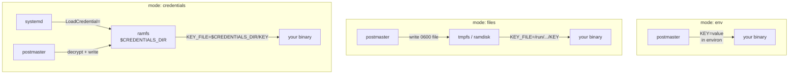

# Injection modes

Postmaster supports three ways to deliver decrypted secrets to the child
process. Each mode makes a different tradeoff between convenience and
security.

## Audience Quickstart

**What this is:** choosing how secrets reach your application — as
environment variables, as files, or as systemd credentials.

| Mode | Best for | Secrets in environ? | Hygiene |
| --- | --- | --- | --- |
| `env` (default) | 12-factor apps, simple services | Yes | Lowest — same-UID processes can read `/proc/PID/environ` |
| `files` | Apps that read `KEY_FILE` pointers (Docker secrets convention) | No — only `_FILE` pointers | Medium — secrets absent from environ, `ps`, crash dumps |
| `credentials` | systemd services wanting strongest isolation | No — reads `$CREDENTIALS_DIRECTORY` | Highest — unit-private unswappable ramfs |

## Mode comparison



## `mode = "env"` (default)

Decrypted values are exported into the process environment and the
wrapper `exec`s your binary. Correct for 12-factor apps.

**Exposure:** environment variables are readable via
`/proc/<pid>/environ` by root and the same UID, inherited by every child,
and prone to appearing in crash dumps and debug output.

**Mitigations:** `DynamicUser=true` (a fresh UID per service — "same UID"
means "this service only"), `ProtectProc` hardening (hides other
processes' `/proc` entries), and ultimately switching to `files` mode.

**No shell expansion:** postmaster performs no `${VAR}`/`$(…)` expansion
anywhere in the decrypt-and-inject path, in any mode. A repo contributor
who commits `KEY=$(cmd)` gets the literal string, never a command
execution at service start.

## `mode = "files"`

Values are written one-file-per-key onto a namespace-private tmpfs
(`TemporaryFileSystem=/run/postmaster`; on macOS, a per-service directory
on an HFS RAM disk) and only `<KEY>_FILE` pointer variables are exported
— the Docker-secrets convention
(`DATABASE_URL_FILE=/run/postmaster/DATABASE_URL`) that many daemons
support natively.

Secrets are absent from environ, `ps e`, crash-dump environment sections,
and ambient child inheritance. The mount is invisible outside the unit's
mount namespace on Linux (root needs `nsenter`) and is destroyed with
the unit. On macOS, the RAM disk is protected by ownership (`0700`), not
invisibility — macOS has no mount namespaces.

Each secret file is written with `O_NOFOLLOW | O_CREAT | O_TRUNC` and
`fchmod`'d to `0600` on the file descriptor (no TOCTOU window between
open and chmod).

For a mostly-file-capable app with a straggler that needs an env var:

```json
{
  "mode": "files",
  "env_files": ["secrets/.env.production"],
  "secrets_dir": "/run/postmaster",
  "passthrough": ["RUST_LOG"]
}
```

Keys in `passthrough` are also exported as real env vars (subject to NUL
rejection, since they become environment variables).

## `mode = "credentials"`

Real systemd credentials, served on demand by the postmaster daemon.
The consumer's unit gets
`LoadCredential=<KEY>:/run/postmaster-credd/<svc>/<KEY>.sock` per key and
the app reads `$CREDENTIALS_DIRECTORY/<KEY>` from unit-private,
**unswappable** ramfs.

No Node, no jq, no shell anywhere in the consumer's start path. The
optional wrapper only exports non-secret `<KEY>_FILE` pointers.
Strongest hygiene of the three.

On macOS, postmaster runs `--bind` (owns its sockets), the wrapper
`postmaster fetch`es each key onto the RAM disk, and exports
`$CREDENTIALS_DIRECTORY` set to `secrets_dir` — same path convention as
systemd credentials, so app code is unchanged.

## Fail-closed rules

- **`strict` (default `true`):** if any value fails to decrypt, the
  entire exec aborts before the child runs. Nothing partial is injected.
- **NUL in env values:** rejected in `env` mode and for `passthrough`
  values in `files` mode. In `files` mode's primary write path, NUL is
  not restricted — the exact bytes reach the file.
- **Empty fetch response:** (`credentials` mode, macOS socket path):
  treated as a refusal, fails closed.
- **Missing `$CREDENTIALS_DIRECTORY`:** fails closed in credentials mode
  (systemd path).

See the [Launcher contract](../reference/launcher-contract.md) for the
complete specification of each mode's fields, validation rules, and
per-mode injected variables.
