# Injection modes

Postmaster supports three ways to deliver decrypted secrets to the child
process. Each mode makes a different tradeoff between convenience and
security.

## Audience quickstart

Choose how secrets reach your application. Storage and process isolation
depend on the deployment as well as the selected mode.

| Mode | Use | Secrets in environ? | Storage and access |
| --- | --- | --- | --- |
| `env` | Apps that read environment variables | Yes | Environment copies can reach process listings, diagnostics, and child processes |
| `files` | Apps that read `KEY_FILE` pointers (Docker secrets convention) | Only when `passthrough` requests it | No environment copy by default; the app still reads plaintext files |
| `credentials` | Apps that read credential files | No additional value copy | Systemd supplies the credentials directory, or Postmaster fetches values from local sockets |

## Mode comparison

```mermaid
flowchart TB
    subgraph env["mode: env"]
        pm_env["postmaster"] -->|KEY=value\nin environ| child_env["your binary"]
    end
    subgraph files["mode: files"]
        pm_files["postmaster"] -->|write 0600 file| tmpfs["tmpfs / ramdisk"]
        tmpfs -->|KEY_FILE=/run/.../KEY| child_files["your binary"]
    end
    subgraph cred["mode: credentials"]
        daemon["postmaster credential daemon"] -->|decrypted bytes over local socket| systemd["systemd"]
        systemd -->|LoadCredential=| ramfs["ramfs\n$CREDENTIALS_DIRECTORY"]
        ramfs -->|KEY_FILE=$CREDENTIALS_DIRECTORY/KEY| child_cred["your binary"]
    end
```



## `mode = "env"`

Postmaster exports resolved values into the application environment and
replaces the launcher with your binary.

**Exposure:** environment variables are readable via
`/proc/<pid>/environ` by root and the same UID, inherited by every child,
and prone to appearing in crash dumps and debug output.

**Mitigations:** `DynamicUser=true` (a fresh UID per service — "same UID"
means "this service only"), `ProtectProc` hardening (hides other
processes' `/proc` entries), and ultimately switching to `files` mode.

**No shell execution:** decrypted values are injected without shell
evaluation. Plaintext dotenv entries follow `dotenvy` parsing rules, including
variable substitution in unquoted and double-quoted values. Single quotes
preserve `${VAR}` literally. `$(cmd)` does not execute a command.

## `mode = "files"`

Deployments provide a namespace-private tmpfs for one-file-per-key output
(`TemporaryFileSystem=/run/postmaster`; on macOS, a per-service directory
on an HFS RAM disk) and only `<KEY>_FILE` pointer variables are exported
— the Docker-secrets convention
(`DATABASE_URL_FILE=/run/postmaster/DATABASE_URL`) that many daemons
support natively.

Secrets are absent from environ, `ps e`, crash-dump environment sections,
and ambient child inheritance. The mount is invisible outside the unit's
mount namespace on Linux (root needs `nsenter`) and is destroyed with
the unit. On macOS, the RAM disk is protected by ownership (`0700`), not
invisibility — macOS has no mount namespaces.

This describes file-only projection. `passthrough` adds environment copies,
and ordinary inherited variables remain present. The application can also
copy file contents into its own memory. A hand-written config must provide
RAM-backed storage; setting `secrets_dir` alone does not verify it.

Each secret refresh publishes a fresh 0600 inode beneath the pinned directory.
Old read handles keep the old contents. Foreign, linked, and special entries
fail closed, and exported paths require protected ancestry. Trusted symlink
aliases and sticky shared parents remain supported.

If the application reads most values from files but needs one in its
environment, list that key in `passthrough`:

```json
{
  "mode": "files",
  "env_files": ["secrets/.env.production"],
  "keys": [{"file": "/var/lib/postmaster/.env.keys"}],
  "secrets_dir": "/run/postmaster",
  "passthrough": ["RUST_LOG"]
}
```

Keys in `passthrough` are also exported as real env vars (subject to NUL
rejection, since they become environment variables).

## `mode = "credentials"`

The launcher exports `<KEY>_FILE` pointers into credentials that systemd has
already supplied. Systemd can obtain those credentials from Postmaster's
daemon. In that deployment, the consumer's unit gets
`LoadCredential=<KEY>:/run/postmaster-credd/<svc>/<KEY>.sock` per key and
the app reads `$CREDENTIALS_DIRECTORY/<KEY>` from unit-private,
**unswappable** ramfs.

The launcher exports file pointers without reading the credential values.
Systemd owns their storage and access controls.

For local socket delivery, normally used with launchd on macOS, the daemon
runs with `--bind`. The launcher fetches each configured key, writes it beneath
`secrets_dir`, and exports `CREDENTIALS_DIRECTORY` along with `<KEY>_FILE`
pointers. The file naming convention matches systemd credentials. The fetch
branch is selected by `sockets`, not by the operating system.

## Fail-closed rules

- **`strict` (default `true`):** if any value fails to decrypt, the
  entire exec aborts before the child runs. Nothing partial is injected.
- **`strict: false`:** undecryptable dotenv values are logged and omitted.
  `--verify-keys` makes those omissions fatal. Bundle entries must authenticate
  under either setting.
- **NUL in env values:** rejected in `env` mode and for `passthrough`
  values in `files` mode. In `files` mode's primary write path, NUL is
  not restricted — the exact bytes reach the file.
- **Empty fetch response:** (`credentials` mode, macOS socket path):
  treated as a refusal, fails closed.
- **Missing `$CREDENTIALS_DIRECTORY`:** fails closed in credentials mode
  (systemd path).

See the [Launcher contract](../reference/launcher-contract.md) for the
complete specification of each mode's fields, validation rules, and
per-mode injected variables.
