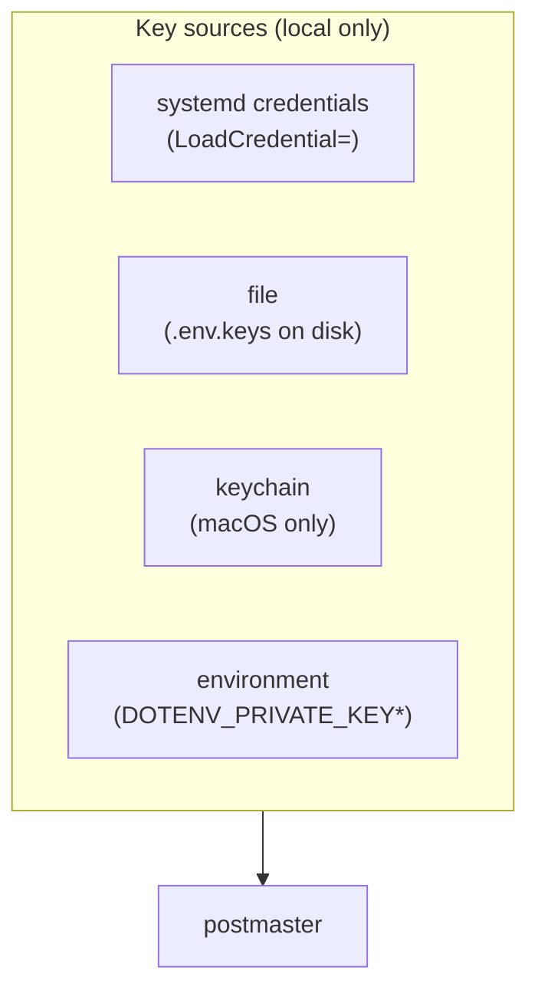
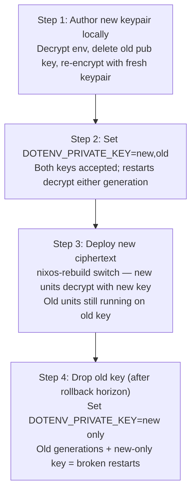

# Key provisioning & rotation

This page covers how to get private keys onto hosts and how to rotate
them without downtime.

## Audience Quickstart

**What this is:** the operational side of postmaster — how the
decryption key gets to the host, and how to rotate it safely.

| Reader | What to take |
| -------- | ------------ |
| Operator / SRE | All sections — this is your playbook |
| Security engineer | The rotation window and fail-closed behavior |
| New user | Skim strategies A and B, come back when you deploy |

## Key source overview

Postmaster reads private keys from local terminal sources only. It never
fetches from remote systems.



## Strategy A: Manual keyfile (default)

One-time per host:

```console
$ sudo install -d -m 0700 /var/lib/postmaster
$ sudo install -m 0400 /dev/stdin /var/lib/postmaster/.env.keys <<'EOF'
DOTENV_PRIVATE_KEY_PRODUCTION="<64-hex from your local .env.keys>"
EOF
```

Ownership matters: `KeyRing::load` requires the keys file to be owned
by the effective uid of the loading process, so `chown` it to the
service user (or run the file-owning step as that user) — a root-owned
keys file fails closed for a service running as a normal user.

## Strategy B: TPM2 / host-sealed blob

Fully declarative — the key is sealed to the host's TPM2 and can only
be decrypted on that specific machine:

```console
# on the target host, once (--name MUST match postmaster-<service>)
$ sudo systemd-creds encrypt --with-key=host+tpm2 \
    --name=postmaster-myapp - myapp-myhost.cred <<'EOF'
DOTENV_PRIVATE_KEY_PRODUCTION="<64-hex>"
EOF
# copy myapp-myhost.cred back into the repo
```

Wire the sealed blob to the launcher's unit with
`LoadCredentialEncrypted=postmaster-myapp:<path to blob>` and reference
the credential name in your config:

```json
{
  "keys": [
    {"credential": "postmaster-myapp"}
  ]
}
```

systemd treats the credential as mandatory: a missing or undecryptable
blob means the unit fails to start. Fail-closed.

Blobs are per-host. Without a TPM, `--with-key=host` binds to
`/var/lib/systemd/credential.secret`.

## Strategy C: Deployment-tool key push

Using colmena or similar:

```nix
deployment.keys."myapp.env.keys" = {
  keyFile = ./deployer-only/myapp.env.keys;
  destDir = "/var/lib/postmaster";
  user = "root"; group = "root"; permissions = "0400";
};
```

As with any keys file, `user` must be the service's own user —
`KeyRing::load` requires the file owner to match the loading process's
effective uid, so `root` here only works for services that run as root.

## Strategy D: macOS Keychain

The recommended path is `postmaster setup`, which seeds the wanted
keychain items interactively. By hand, use `security
add-generic-password` *without* `-w` so it prompts for the value:

```console
$ security add-generic-password -a DOTENV_PRIVATE_KEY_PRODUCTION \
    -s postmaster
```

Avoid `-w "<hex>"`: it puts the private key in the process argv,
visible to every process on the host via `ps`.

No file on disk — keys live as generic-password items in the default
keychain search list. Postmaster reads them natively via the
Security.framework API (`security-framework` crate).

`postmaster setup` hides terminal input for both key files and Keychain values.
It restores terminal settings when input finishes, fails, or receives a
catchable termination or suspend signal. Redirected key-file input still
accepts multiple lines through EOF. `--force` publishes a fresh 0600 key-file
inode after confirmation and refuses a substituted, foreign, linked, or
special file. Existing open handles keep the old contents.

## Rotation

No `rotate` subcommand exists. The flow is manual, but
`DOTENV_PRIVATE_KEY*` accepts **comma-separated keys** for a
zero-downtime window (the bundle adapter's `POSTMASTER_KEY` variable —
no per-environment suffix — follows the same convention):



1. Locally: decrypt the env file, delete the old public key and
   `.env.keys` entry, re-encrypt with a fresh keypair.
2. On hosts: set `DOTENV_PRIVATE_KEY_PRODUCTION="<new>,<old>"` (re-seal
   the blob in strategy B). Running units are untouched; restarts
   decrypt either generation.
3. Deploy the new ciphertext (`nixos-rebuild switch`).
4. Drop `<old>` once past your rollback horizon — an old generation plus
   a new-only key means broken restarts.

Use `--verify-keys` to catch stale keys before they cause a silent
failure:

```console
$ postmaster exec --config exec.json --verify-keys -- /usr/bin/true
```

For daemon mode, authorize the new dotenv file's SHA-256 in each entry's
`env_file_sha256` list before deploying it. Keep both old and new hashes during
the rotation window, then remove the old hash. Hashes cover the complete file,
including plaintext, comments, and line endings. Compute them from the trusted
artifact; do not derive authorization from a runtime copy that can be changed.
Exec configurations continue to select application inputs through `env_files`.
