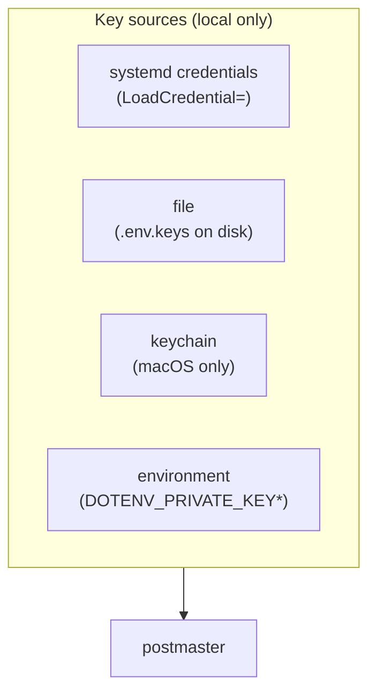
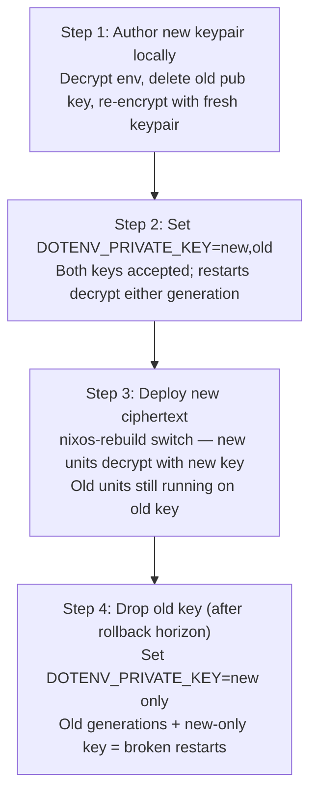

# Key provisioning & rotation

This page covers how to get private keys onto hosts and how to rotate
them without downtime.

## Audience Quickstart

**What this is:** the operational side of postmaster — how the
decryption key gets to the host, and how to rotate it safely.

| Reader | What to take |
| -------- | ------------ |
| Operator / SRE | All sections — this is your playbook |
| Security engineer | The rotation window and fail-closed behavior |
| New user | Skim strategies A and B, come back when you deploy |

## Key source overview

Postmaster reads private keys from local terminal sources only. It never
fetches from remote systems.



## Strategy A: Manual keyfile (default)

One-time per host:

```console
$ sudo install -d -m 0700 /var/lib/postmaster
$ sudo install -m 0400 /dev/stdin /var/lib/postmaster/.env.keys <<'EOF'
DOTENV_PRIVATE_KEY_PRODUCTION="<64-hex from your local .env.keys>"
EOF
```

systemd treats an absolute-path credential as mandatory: missing file
means the unit fails to start. Fail-closed.

## Strategy B: TPM2 / host-sealed blob

Fully declarative — the key is sealed to the host's TPM2 and can only
be decrypted on that specific machine:

```console
# on the target host, once (--name MUST match postmaster-<service>)
$ sudo systemd-creds encrypt --with-key=host+tpm2 \
    --name=postmaster-myapp - myapp-myhost.cred <<'EOF'
DOTENV_PRIVATE_KEY_PRODUCTION="<64-hex>"
EOF
# copy myapp-myhost.cred back into the repo
```

Reference the sealed blob in your config:

```json
{
  "keys": [
    {"file": "/nix/store/...-myapp.cred"}
  ]
}
```

Blobs are per-host. Without a TPM, `--with-key=host` binds to
`/var/lib/systemd/credential.secret`.

## Strategy C: Deployment-tool key push

Using colmena or similar:

```nix
deployment.keys."myapp.env.keys" = {
  keyFile = ./deployer-only/myapp.env.keys;
  destDir = "/var/lib/postmaster";
  user = "root"; group = "root"; permissions = "0400";
};
```

## Strategy D: macOS Keychain

```console
$ security add-generic-password -a DOTENV_PRIVATE_KEY_PRODUCTION \
    -s postmaster -w "<64-hex>"
```

No file on disk — keys live as generic-password items in the System
keychain. Postmaster reads them natively via `security(1)`.

## Rotation

No `rotate` subcommand exists. The flow is manual, but
`DOTENV_PRIVATE_KEY*` accepts **comma-separated keys** for a
zero-downtime window:



1. Locally: decrypt the env file, delete the old public key and
   `.env.keys` entry, re-encrypt with a fresh keypair.
2. On hosts: set `DOTENV_PRIVATE_KEY_PRODUCTION="<new>,<old>"` (re-seal
   the blob in strategy B). Running units are untouched; restarts
   decrypt either generation.
3. Deploy the new ciphertext (`nixos-rebuild switch`).
4. Drop `<old>` once past your rollback horizon — an old generation plus
   a new-only key means broken restarts.

Use `--verify-keys` to catch stale keys before they cause a silent
failure:

```console
$ postmaster exec --config exec.json --verify-keys -- /usr/bin/true
```
