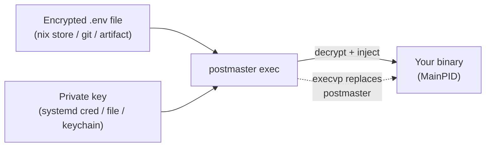

# Introduction

Postmaster decrypts local secret inputs at process launch and delivers values
through environment variables, files, or systemd credentials. It then replaces
the launcher with the target binary through `execvp`.

## Audience quickstart

Decryption runs in Rust. Postmaster doesn't evaluate secret values as shell
code. Deployments provide RAM-backed storage for file projections and
configure swap and dump protection. The service manager owns the service;
a sibling monitor handles stop-signal forwarding and file cleanup.

### Who this is for

| Reader | What to take from this doc |
| -------- | ------------------------------ |
| New user / junior engineer | The introduction and [Quick start](./getting-started/quick-start.md); then [Injection modes](./getting-started/injection-modes.md) |
| Platform / SRE | [Key provisioning](./getting-started/key-provisioning.md) and the [Threat model](./architecture/threat-model.md) |
| Security engineer | The [Threat model](./architecture/threat-model.md) and [Materialization ABI](./architecture/materialization-abi.md) |
| Integration author | The [Launcher contract](./reference/launcher-contract.md) and [CLI reference](./reference/cli.md) |
| Product / project manager, engineering leadership | The [Executive overview](./executive-overview.md), then this introduction |

### Quick glossary

| Term | Plain meaning |
| ------ | --------------- |
| **Materialization** | Decrypting secrets and putting them where your app can read them (env vars, files, or credentials) |
| **execvp** | A Unix system call that replaces the current process with a new binary — postmaster becomes your app |
| **ECIES** | Elliptic Curve Integrated Encryption Scheme — the crypto used to encrypt individual secret values |
| **exec.json** | A JSON config file that selects inputs, key sources, and projection mode. The command to launch is supplied separately after `--`. |
| **Key source** | Where the decryption key comes from (a file, systemd credentials, macOS keychain, or environment) |
| **Injection mode** | How decrypted secrets reach the child: `env` (environment variables), `files` (one file per secret), or `credentials` (systemd credentials) |
| **Ciphertext** | Encrypted data — safe to store in git, the Nix store, or any world-readable location |

## The core problem

Services need secrets at runtime. Storing them in plaintext in a container
image, deployment manifest, or persistent file creates additional copies to
protect. Delivery methods have different exposure:

- **Shell wrappers** that evaluate secret values as code can execute
  `$(...)` or backticks embedded in those values.
- **Parent processes** that stay alive can retain keys and decrypted values
  for the service's lifetime.
- **Network delivery** adds a dependency to the startup path.
- **Plaintext environment configuration** can expose values through unit
  files, container specifications, process listings, and dumps.

Postmaster decrypts locally, injects directly, and replaces the launcher
with your binary. It wipes its key ring and resolved buffers before launch.
Deployments provide RAM-backed secret storage and configure swap and dump
protection. The application keeps access to the secrets it uses.

## What Postmaster does

1. **Decrypts** encrypted `.env` files (or `postmaster_bundle` JSON
   containers) using native Rust cryptography. Bundle entries use Postmaster's
   AAD decoder with released ECIES helpers and RustCrypto AES-GCM.

2. **Injects** decrypted values into the child via one of three modes:
   - `env` — environment variables (12-factor apps)
   - `files` — one file per secret on a RAM-backed filesystem (Docker
     secrets convention, `KEY_FILE` pointers)
   - `credentials` — pointers to systemd credentials or values fetched
     from configured local sockets

3. **Launches** the target binary via `execvp` — postmaster is replaced
   by your binary. The service process remains `MainPID` from its first
   instruction. A sibling monitor handles stop signals and file cleanup.

4. **Cleans up** — `postmaster cleanup` removes plaintext secret files
   after the child exits, wired to `ExecStopPost` in systemd.

## How Postmaster works

The ciphertext is designed to be public. Every value is
ECIES/secp256k1-encrypted individually — the public key embedded in
the file only permits encrypting new values, never decrypting existing
ones. This allows encrypted values in the Nix store, git, or an artifact
registry. Private keys still need separate protection. Anyone with the public
key can encrypt replacement values, so artifact write access remains trusted.

## The secret pipeline

Postmaster handles local materialization and process launch in this pipeline:
custody
(Vault/SSM/1Password/TPM2) → rendering (Nix/Terraform/CDK/Ansible) →
delivery (systemd credentials/files/keychain/env) → **materialization
(postmaster)** → launch (execvp). The stage diagram, table, and
per-stage detail live in
[postmaster — the secret pipeline](./architecture/postmaster.md#the-secret-pipeline).

External tools own custody, rendering, and delivery. Postmaster doesn't fetch
from remote stores or deploy infrastructure. Its monitor forwards stop signals
and cleans up plaintext files; the service manager owns restarts and health
checks.

The monitor scrubs the projected environment pairs, but retains the original
process environment. Environment-supplied private keys can remain there.
The optional credential daemon also retains its key ring while serving
requests. See the [Threat model](./architecture/threat-model.md) for these
limits and the deployment requirements.

## Capabilities and scope

- `.env` adapter (wire-compatible with dotenvx), `postmaster_bundle`
  JSON container, three injection modes, four key sources (systemd
  credentials, files, keychain, environment), `--verify-keys` freshness
  check, `setup` command, `cleanup` command.
- **Scope:** remote secret-store clients, plugin systems, an async runtime,
  and a CLI parsing library are outside Postmaster's runtime contract.

## First input adapter

The first input adapter is wire-compatible with
[dotenvx](https://github.com/dotenvx/dotenvx)-encrypted `.env` files
(same ECIES/secp256k1 + HKDF-SHA256 + AES-256-GCM crypto path), so
existing `.env` files encrypted with the dotenvx CLI decrypt byte-exact
through postmaster's native Rust implementation.

The bundle adapter provides a second input format. Vault, AWS SSM, and other
custody systems can deliver key material to local sources before launch.
Postmaster reads those local sources; it doesn't contact the remote store.
