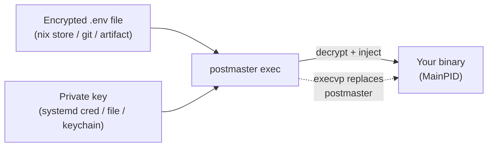
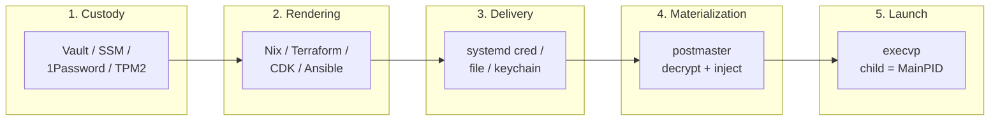

# Introduction

postmaster is a **standalone, format-neutral local secret materialization
engine**. It decrypts encrypted secret inputs at process launch time and
injects them into a child process via environment variables, files, or
systemd credentials — then `execvp`s the target binary directly. No Node,
no shell, no separate CLI process in the runtime path.

## Audience Quickstart (Plain Language)

**What this is:** a tool that takes encrypted secrets (like database
passwords and API tokens) and safely puts them into your service's
environment at startup — without writing plaintext to disk, without
running a shell, and without keeping a long-lived parent process that
holds secrets in memory.

### Who this is for

| Reader | What to take from this docs |
| -------- | ------------------------------ |
| New user / junior engineer | The introduction and [Quick start](./getting-started/quick-start.md); then [Injection modes](./getting-started/injection-modes.md) |
| Platform / SRE | [Key provisioning](./getting-started/key-provisioning.md) and the [Threat model](./architecture/threat-model.md) |
| Security engineer | The [Threat model](./architecture/threat-model.md) and [Materialization ABI](./architecture/materialization-abi.md) |
| Integration author | The [Launcher contract](./reference/launcher-contract.md) and [CLI reference](./reference/cli.md) |
| Product / project manager | This introduction and the [postmaster](./architecture/postmaster.md) overview |

### Quick glossary

| Term | Plain meaning |
| ------ | --------------- |
| **Materialization** | Decrypting secrets and putting them where your app can read them (env vars, files, or credentials) |
| **execvp** | A Unix system call that replaces the current process with a new binary — postmaster becomes your app |
| **ECIES** | Elliptic Curve Integrated Encryption Scheme — the crypto used to encrypt individual secret values |
| **exec.json** | A JSON config file that tells postmaster what to decrypt, how to inject, and what binary to launch |
| **Key source** | Where the decryption key comes from (a file, systemd credentials, macOS keychain, or environment) |
| **Injection mode** | How decrypted secrets reach the child: `env` (environment variables), `files` (one file per secret), or `credentials` (systemd credentials) |
| **Ciphertext** | Encrypted data — safe to store in git, the Nix store, or any world-readable location |

## The Core Problem

Deploying secrets to production services is hard. The secrets need to
be present at runtime, but they must not be stored in plaintext on disk,
in the container image, or in the deployment manifest. Common approaches
each have tradeoffs:

- **Shell wrappers** run a script that `eval`s secrets — vulnerable to
  command injection if a secret contains `$(...)` or backticks.
- **External CLIs** (Node, Python) stay alive as a parent process —
  secrets persist in the parent's heap for the service's entire lifetime.
- **Sidecar containers** inject secrets over the network — adds a
  network dependency to the startup path.
- **Manual env vars** put plaintext secrets in the systemd unit file or
  the container spec — visible in `ps`, `systemctl cat`, and crash dumps.

Postmaster takes a different approach: decrypt locally, inject directly,
replace the process image. The secret material exists in process memory
for a brief window, never touches persistent disk, and the process that
held the secrets is gone the moment your binary starts.

## What postmaster Does

1. **Decrypts** encrypted `.env` files (or `postmaster_bundle` JSON
   containers) using the `ecies` crate — native Rust, no network calls,
   no external CLIs, no shell.

2. **Injects** decrypted values into the child via one of three modes:
   - `env` — environment variables (12-factor apps)
   - `files` — one file per secret on a RAM-backed filesystem (Docker
     secrets convention, `KEY_FILE` pointers)
   - `credentials` — systemd credentials (strongest hygiene)

3. **Launches** the target binary via `execvp` — postmaster is replaced
   by your binary. The child process IS `MainPID` from its first
   instruction. No parent process holds secrets.

4. **Cleans up** — `postmaster cleanup` removes plaintext secret files
   after the child exits, wired to `ExecStopPost` in systemd.

## How postmaster Works

The ciphertext is designed to be public. Every value is
ECIES/secp256k1-encrypted individually — the public key embedded in
the file only permits encrypting new values, never decrypting existing
ones. So the world-readable Nix store, git repo, or artifact registry
stops being an adversary. The entire secret surface collapses to one
64-hex private key per environment.

## The Secret Pipeline

Postmaster owns exactly one stage in a 5-stage pipeline. Understanding
which stage each system owns is the key to understanding what postmaster
is (and is not).

| Stage | Who owns it | What happens |
| ----- | ----------- | ------------ |
| 1. Custody | Vault, AWS SSM, 1Password, TPM2 | Private keys live in a source/custody system |
| 2. Rendering | Nix, Terraform, CDK, Ansible, Salt, Puppet | Encrypted artifacts + key material + service wiring get onto the host |
| 3. Delivery | systemd, files, keychain, env | Key material reaches postmaster at runtime via local sources |
| 4. Materialization | **postmaster** | Postmaster decrypts and injects — this is the only stage it owns |
| 5. Launch | execvp | Process image replaced; child binary is MainPID |

Postmaster does not participate in stages 1-3. It does not fetch from
remote systems, does not deploy infrastructure, and does not supervise
the child process. It decrypts, injects, and gets out of the way.

## Capability Horizon

- `.env` adapter (wire-compatible with dotenvx), `postmaster_bundle`
  JSON container, three injection modes, four key sources (systemd
  credentials, files, keychain, environment), `--verify-keys` freshness
  check, `setup` command, `cleanup` command.
- **Non-goals:** postmaster will never become a network client for Vault,
  SSM, or any remote secret store. It will not add a plugin system, an
  async runtime, or a CLI parsing library.

## First input adapter

The first input adapter is wire-compatible with
[dotenvx](https://github.com/dotenvx/dotenvx)-encrypted `.env` files
(same ECIES/secp256k1 + HKDF-SHA256 + AES-256-GCM crypto path), so
existing `.env` files encrypted with the dotenvx CLI decrypt byte-exact
through postmaster's native Rust implementation.

dotenvx is one adapter, not the ceiling — the architecture supports
file-based (`.env`), HashiCorp Vault, AWS SSM, and other secret providers
as source/custody backends. But those systems deliver key material to
local terminal sources; postmaster reads from those local sources and
never reaches across the network.
