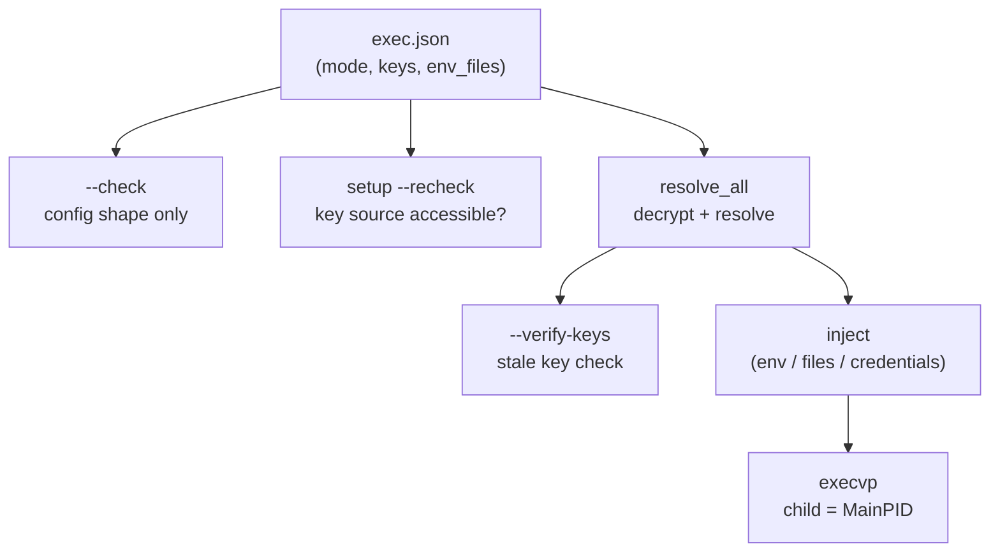

# Launcher contract (exec.json)

## Audience Quickstart (Plain Language)

**What this is:** the complete specification of `exec.json` — every
field, every mode, every validation rule. This is the contract a
binding (Nix, Terraform, CDK, Ansible) must produce.

### Who this is for

| Reader | What to take |
| -------- | ------------ |
| Integration author | The entire page — your binding must produce this exact format |
| Security engineer | "Fail-closed rules" and per-mode validation |
| New user | "Invocation" and the config example — enough to get started |
| Platform / SRE | "Invocation" and `--check` / `--recheck` validation commands |

### Quick glossary

| Term | Plain meaning |
| ------ | --------------- |
| **exec.json** | JSON config that tells postmaster what to decrypt and how to launch |
| **Projection mode** | How secrets reach the child: env, files, or credentials |
| **Key source** | Where the decryption key comes from (file, credential, keychain, env) |
| **Strict** | If true (default), any decryption failure aborts the launch |
| **Passthrough** | In files mode, specific keys also exported as env vars |

`postmaster exec` is the concrete instance of the
[materialization ABI](../architecture/materialization-abi.md).
The current config shape is
the `.env` adapter: encrypted inputs are `env_files`, private key material uses
the `.env.keys` / `DOTENV_PRIVATE_KEY*` convention, and output projection is
selected with `mode`. This page documents the committed parser and launcher
behavior; the ABI page records how this contract fits into the broader
format-neutral architecture.

`postmaster exec` is a second entry point alongside the credential daemon:
instead of serving decrypted values over a socket, it decrypts once, injects
them into a child process by one of three modes, and `execvp`s a target
command. It exists so that bindings that cannot rely on systemd's
`LoadCredential=` socket contract — Ansible, Puppet, Terraform/CDK,
hand-rolled process supervisors, or nix-darwin's launchd — get the
same decrypt-and-inject semantics as the Linux daemon path, without
templating shell or re-implementing the crypto.

This page is **the** cross-binding contract. The Nix module is the first
binding to emit `exec.json`; it is not privileged over any other binding.
**A binding is correct if and only if the `exec.json` it emits is
described by this document and passes the conformance suite.**
Nothing here documents intent or a roadmap; every claim below is true
of the committed parser and launcher (`src/config.rs`,
`src/launcher.rs`, `src/keys.rs`) as of this writing.

### Config to launch flow



## Reference implementation

The `.env` semantics this contract mirrors — encrypted-value format,
`.env.keys` rotation via comma-separated candidates, `DOTENV_PRIVATE_KEY*`
naming, `--strict`/`--overload` precedence — are wire-compatible with
[dotenvx](https://github.com/dotenvx/dotenvx)-encrypted `.env` files.
`postmaster exec` does not shell out to any external CLI at all — it
implements the decrypt path natively in Rust (same `ecies` crate the
daemon uses) — but wherever this document describes a precedence or
filtering rule, it describes the wire-compatible behavior, not a
postmaster-only invention.

## Invocation

```console
$ postmaster exec --config <exec.json> -- <command> [args…]
$ postmaster exec --config <exec.json> --check
$ postmaster exec --config <exec.json> [--verify-keys] -- <command> [args…]
$ postmaster setup --config <exec.json> [--recheck] [--unattended] [--force] [--keys-dir <path>]
$ postmaster cleanup --config <exec.json>
```

- `--config <path>` is required and must come before `--`.
- Everything after `--` is the argv of the child process; it must be
  non-empty (`exec: missing command after` `` `--` `` otherwise).
- `--check` validates the public config shape and exits without decrypting,
  reading key material, checking the filesystem, fetching sockets, or
  launching the child command. It does not accept a command after `--`.
- `--verify-keys` performs a preflight check: after loading and decrypting,
  if the resolved values are empty but the env files contain `encrypted:`
  values, the keys are stale (from a previous rotation cycle) and the exec
  aborts with a clear error. This catches the `strict: false` case where
  stale keys would silently skip undecryptable values and launch the child
  with no secrets.
- `setup` verifies platform prerequisites, creates keys directory with
  0700, verifies/creates keys files with 0600, optionally seeds keychain
  items (macOS), and validates the environment. Idempotent. `--recheck`
  is verification-only. `--unattended` fails closed without prompting.
  `--force` re-creates/re-seeds even if correct. `--keys-dir` overrides
  the default path (`/var/lib/postmaster` on Linux,
  `~/Library/Application Support/postmaster` on macOS).
  **`--check` validates config shape only, not key source accessibility:**
  a config can pass `--check` in CI but fail at runtime because the key
  file is missing, the keychain item is absent, or the credential source
  is not provisioned. Runtime key source accessibility is verified by the
  launcher itself (fail-closed on missing/unreadable keys); `--check`
  cannot guarantee the handoff will work, only that the config is
  well-formed.
- On success the process image is replaced (`execvp`); postmaster never
  returns. On failure to exec the target binary itself, the error is logged
  and returned as a non-zero exit — nothing beyond this point is
  fail-open.

## `ExecConfig` fields

`exec.json` deserializes into this struct (`src/config.rs`).
Unknown root fields are rejected. ABI fields such as `version` or
`adapter` must not be emitted until the parser and schema explicitly define
them. A machine-readable JSON Schema for this current shape is kept at
`docs/schema/exec.schema.json`, with parser-checked examples under
`docs/examples/`.
Every field except `mode` has a default, so a minimal config is just
`{"mode": "credentials", "credential_keys": ["DB_URL"]}`.

| Field | Type | Default | Meaning |
|---|---|---|---|
| `mode` | `"env" \| "files" \| "credentials"` | — (required) | Injection mode; see below. |
| `keys` | array of key-source specs | `[]` | Ordered list of where to obtain `DOTENV_PRIVATE_KEY*` material. Unused in `credentials` mode. |
| `env_files` | array of paths | `[]` | Encrypted `.env[.<environment>]` files, in precedence order (first file wins unless `overload`). Required (non-empty) for `env`/`files` modes. |
| `bundle_files` | array of paths | `[]` | Encrypted `postmaster_bundle` JSON containers, in precedence order. Entries are merged with `env_files`; bundle keys use the same identifier rule and injection modes. |
| `strict` | bool | **`true`** | Any value that fails to decrypt aborts the whole exec before the child runs. |
| `overload` | bool | `false` | File-derived values override the process environment; later files override earlier ones. |
| `secrets_dir` | path or `null` | `null` | `files` mode, and `credentials` mode on the launchd/fetch path: directory plaintext files are written into. |
| `passthrough` | array of strings | `[]` | `files` mode only: these keys are *also* exported as real env vars, in addition to their `_FILE` pointer. |
| `credential_keys` | array of strings | `[]` | `credentials` mode: keys to expose as `$CREDENTIALS_DIRECTORY/<KEY>`. Required (non-empty) for that mode. |
| `sockets` | map of key → socket path | `{}` | `credentials` mode: postmaster socket to fetch `<KEY>` from. Non-empty selects the darwin/launchd fetch path; empty means systemd already materialized the credentials via `LoadCredential=`. |
| `verify_ramdisk` | path or `null` | `null` | darwin only: refuse to write plaintext unless this mount point is the HFS ramdisk and `secrets_dir` is a directory owned by the current euid. |

Note the field name is `verify_ramdisk`, not `ramdisk` or `ramdisk_mount` —
match it exactly.

Mode-required fields are enforced by `postmaster exec --check` and again
before a real launch:

- `env` requires non-empty `keys` and non-empty `env_files`.
- `files` requires non-empty `keys`, non-empty `env_files`, and
  `secrets_dir`.
- `credentials` requires non-empty `credential_keys`. If `sockets` is
  non-empty, it also requires `secrets_dir` and a socket mapping for every
  credential key.

`--check` also validates env-file basenames, rejects private-key
`file` sources under `/nix/store`, rejects path-like `credential` source
names, and applies identifier validation to `passthrough` and
`credential_keys`.

**Mode-irrelevant fields are rejected.** `--check` and the pre-launch
validation fail fast if a config includes fields that do not belong to the
selected mode — before any secret material transits. This catches binding
bugs where a config generator accidentally emits, for example, `env_files`
in a credentials-mode config or `credential_keys` in an env-mode config.
Default/empty values (empty arrays, `null`, `false`) are accepted, since
serde fills those in even when the generator omits the field.

| Mode | Rejected if present (non-default) |
|---|---|
| `env` | `secrets_dir`, `credential_keys`, `sockets`, `verify_ramdisk`, `passthrough` |
| `files` | `credential_keys`, `sockets` |
| `credentials` | `keys`, `env_files`, `overload`, `passthrough` |

## Key-source list (`keys`)

Each entry in `keys` is one externally-tagged JSON shape:

| JSON | Meaning |
|---|---|
| `{"credential": "<name>"}` | `$CREDENTIALS_DIRECTORY/<name>` (the launcher's *own* `LoadCredential`, i.e. `.env.keys` handed to it the same way postmaster's daemon receives its own). `<name>` must be a single relative path component, not `.`, `..`, an absolute path, or a slash-containing path. |
| `{"file": "<path>"}` | An out-of-store `.env.keys`-format file read directly. Rejected outright if the path starts with `/nix/store` — private keys must never live in the world-readable store. |
| `{"keychain": "<service>"}` | macOS System keychain; one generic-password item per `DOTENV_PRIVATE_KEY[_<ENV>]` account, service name as given. Only the variables actually needed (derived from `env_files`) are fetched. Any other target: error, "only available on macOS". |
| `"environment"` | The unit-variant source — note it is a bare JSON string, not an object, because it carries no data. Reads `DOTENV_PRIVATE_KEY*` straight from postmaster's own process environment. |

**Selection contract**, evaluated in list order:

- `credential` is **skippable**: if `$CREDENTIALS_DIRECTORY` is unset, or
  the named file doesn't exist under it, the launcher falls through to the
  next entry in `keys`. If the file *does* exist, whatever
  `KeyRing::load` returns (success or parse error) is final — a bad
  keys file under an existing credential does not fall through.
- `file`, `keychain`, and `environment` are **terminal**: the first time
  one of these is reached, its result — success or failure — is the
  result of key-ring selection. There is no fallback past a terminal
  source.
- If every entry in `keys` is exhausted without returning (i.e. every
  entry was a skippable, absent `credential`), or `keys` is empty:
  `"no usable key source (configure keys=[…] or set DOTENV_PRIVATE_KEY*)"`.

`credentials` mode never touches `keys` or `env_files` at all — no
decryption happens in that mode; see below.

## Precedence contract

This is the contract `resolve_all` (`src/keys.rs`) implements,
verbatim:

- **Within one file, the last assignment wins** — ordinary dotenv
  semantics. `A=1` followed later in the same file by `A=2` yields `2`.
- **Across files, the first file that defines a key wins**, in the order
  `env_files` lists them — *unless* `overload` is `true`, in which case
  the **last** file defining the key wins. Note: which file wins does not
  change the *position* a key is emitted in; a key's slot is fixed by
  the first file that introduces it, `overload` only changes which
  file's value fills that slot.
- **Process-environment presence suppresses the file-derived value**,
  but only when `overload` is `false`: if the variable is already set
  in postmaster's process environment, it is dropped from the resolved
  set entirely (the child inherits the parent's existing value
  unmodified, since `exec()` only *adds* the resolved pairs on top of an
  inherited environment). When `overload` is `true`, process environment
  is not consulted at all — file values always win.

## `DOTENV_` filtering and identifier validation

- Any raw key beginning with `DOTENV_` (not just the private/public key
  vars) is dropped during parsing — metadata, never a value to inject.
- Every remaining key must match `[A-Za-z_][A-Za-z0-9_]*`
  (`crate::keys::is_ident`) — ASCII letters/digits/underscore, first
  character not a digit. A key that fails this is a hard parse error
  (`"<file>: refusing non-identifier key <k>"`), not a skip: a key from
  an encrypted file will end up as a shell-visible env-var name or a
  filename component, so this is enforced before any value from that
  file is used at all.
- `credential_keys` (used only in `credentials` mode, where there is no
  `resolve_all` pass) is validated against the same `is_ident` rule
  up front, before any file is written or any socket is fetched
  (`validate_credential_keys`) — a bad key later in the list (e.g.
  `"../evil"`, an absolute path, or a name containing `/`) can't leave a
  partial plaintext write behind, and can't be used to escape
  `secrets_dir` or forge an arbitrary env-var name.

## Encrypted-value format

A raw value that does not start with `encrypted:` is passed through
verbatim as opaque bytes (this is how plaintext values reach the child —
no decryption attempted). A value that does start with `encrypted:` has the
following payload base64-decoded and decrypted with `ecies` against each
candidate key under the matching `DOTENV_PRIVATE_KEY*` name
(comma-separated rotation candidates in `.env.keys` are tried in order;
first one that decrypts wins).

**Lenient base64 decoding:** the payload after `encrypted:` may contain
ASCII whitespace (spaces, tabs, newlines, carriage returns). If any is
present, it is stripped before decoding, so a value that has been
line-wrapped decodes identically to the same value on one line. This
matches the wire-compatible behavior for line-wrapped encrypted values and
is exercised directly in `tests/exec_conformance.rs`
(`wrapped_base64_ciphertext_decrypts`).

`key_var_for` maps an env-file name to the private-key variable it needs:
`.env` → `DOTENV_PRIVATE_KEY`; `.env.production` →
`DOTENV_PRIVATE_KEY_PRODUCTION`; non-alphanumeric characters in the
environment suffix become `_` and the whole suffix is upper-cased. A file
name that doesn't start with `.env` is a hard parse error.

## Per-mode injected variables

**`mode: "env"`.** Decrypts `env_files` through the key ring in `keys`,
then exports every resolved `KEY=value` pair directly into the child's
environment. No pointer files, no `secrets_dir`. A resolved value
containing a NUL byte is a hard error
(`"<key>: value contains a NUL byte; cannot be an environment variable
(use files mode)"`) — environment variables cannot hold NUL, so this fails
closed rather than silently truncating.

**`mode: "files"`.** Requires `secrets_dir`. If `verify_ramdisk` is set,
the ramdisk guard (below) runs first; otherwise `secrets_dir` merely has
to exist and be a directory. Each resolved value is written to
`<secrets_dir>/<KEY>` with permissions forced to `0600` (via `fchmod` on
the file descriptor after `O_NOFOLLOW | O_CREAT | O_TRUNC` open, so the
permission is set atomically without a TOCTOU window) — unlike `env` mode,
values here may contain NUL; the file is written byte-exact. For each key
the launcher exports `<KEY>_FILE` pointing at that path; if the key is
also listed in `passthrough`, it is *additionally* exported as a real
`<KEY>=value` env var (and *that* copy is subject to the same NUL-rejection
rule as `env` mode, since it becomes a real env var).

**`mode: "credentials"`.** Requires non-empty `credential_keys`
(validated as identifiers up front, see above). No decryption occurs in
this mode — it dispatches on whether `sockets` is empty:

- **`sockets` empty (systemd path):** pid 1 has already materialized the
  credentials via `LoadCredential=` before the unit's `ExecStart` runs.
  Requires `$CREDENTIALS_DIRECTORY` to be set in the *process*
  environment (`"postmaster credentials expected but
  CREDENTIALS_DIRECTORY is unset"` otherwise — a fail-closed guard
  against running this mode outside systemd). For each key, exports
  `<KEY>_FILE=$CREDENTIALS_DIRECTORY/<KEY>` — no reading, no
  permission changes; systemd already owns that file.
- **`sockets` non-empty (darwin/launchd fetch path):** requires
  `secrets_dir`; runs the ramdisk guard if `verify_ramdisk` is set. For
  each key, looks up its socket in `sockets` (missing entry is an error),
  connects and reads to EOF via the same client path `postmaster fetch`
  uses, writes the bytes to `<secrets_dir>/<KEY>` at `0600`, and exports
  `<KEY>_FILE`. After all keys, exports **both**
  `CREDENTIALS_DIRECTORY` set to `secrets_dir`
  — unlike the systemd branch, there is no real `LoadCredential`
  mechanism on darwin, so the launcher has to tell the consumer that
  `secrets_dir` *is* its credentials directory.

## Fail-closed rules

- **`strict` (default `true`).** In `env`/`files` modes, if any value
  fails to decrypt (bad key, wrong key, malformed ciphertext), the whole
  exec aborts before the child runs — nothing partial is injected. With
  `strict: false`, an undecryptable value is logged and simply omitted
  from the resolved set (never served as an error string or empty value).
- **NUL in an environment value** is refused in `env` mode and for
  `passthrough` values in `files` mode (see above); in `files` mode's
  primary write path (the pointer-file contents), NUL is not restricted
  — the exact bytes reach the file.
- **Empty fetch response** (`credentials` mode, darwin socket path):
  `fetch_bytes` treats a zero-byte read as the server having refused to
  serve, and fails closed with `"<path>: server sent zero bytes (refused
  to serve); failing closed"` rather than writing an empty credential
  file.
- **Missing `$CREDENTIALS_DIRECTORY`** in `credentials` mode's systemd
  branch fails closed rather than silently exporting nothing.
- **Private keys never come from the Nix store.** A `{"file": …}` key
  source under `/nix/store` is refused outright, even before attempting
  to read it — the store is world-readable, so a private key living
  there is not private.
- **Keys file permissions and ownership.** `KeyRing::load` opens the
  keys file with `O_NOFOLLOW` and `fstat`s the fd to verify: no
  group/world access (`mode & 0o077 == 0`), and owned by the current
  euid. A world-readable or symlinked keys file fails closed.
- **External binary verification.** On macOS, `from_keychain` verifies
  the code signature of `/usr/bin/security` via `codesign -v` before
  invoking it. On Linux, external binaries are verified as regular files
  owned by root (uid 0) and not world-writable.
- **`verify_ramdisk` (darwin ramdisk guard).** When set, before any
  plaintext is written the launcher runs two checks: it shells out to
  `/sbin/mount` and requires the configured mount point to appear as an
  `hfs` filesystem, then runs `hdiutil info` and requires the device's
  `image-path` to start with `ram://` (confirming RAM backing, not a
  file-backed image). It then `stat`s `secrets_dir` and requires it to
  exist, be a directory, and be owned by the launcher's own effective
  uid. Either check failing refuses to write plaintext to what might be
  persistent disk, with an error pointing at `postmaster-ramdisk`
  health.

## Extensibility boundary

`KeySourceSpec` is the boundary between postmaster and the systems around
it. The implemented source kinds are deliberately local and terminal:
`credential`, `file`, `keychain`, and `environment`. postmaster rejects any
unknown key-source kind at JSON-parse time; an unknown tag is a
deserialize error, not a silently-ignored source.

Provider names such as `vault` and `aws_ssm` are reserved for the contract,
but native network key sources are out of scope for the current threat
model. postmaster must not become an AWS SSM client, a Vault client, or a
general secret-store plugin host. Those systems are supported as upstream
custody/source platforms: they deliver `.env.keys`-format private-key
material into one of the implemented local sources, and postmaster remains
the offline runtime decrypt/inject boundary.

The obligations run in different directions for postmaster and for
bindings:

- **postmaster** validates the `exec.json` shape, enforces the implemented
  source semantics, decrypts locally, injects locally, and fails closed.
- **A binding** must only emit source kinds it actually knows the semantics
  of. A binding that generates configs should treat an unrecognized source
  kind in its own templates as a bug in itself, not rely on postmaster to
  validate binding-author intent.

## Composition recipes

None of these need new code in postmaster, and none of them put a network
client in postmaster's secret path. They compose the local key sources
with external secret-management tooling that materializes a
`DOTENV_PRIVATE_KEY*` file, credential, or keychain item before
`postmaster exec` runs:

- **Vault Agent → `{"file": …}`.** Point a Vault Agent template at
  rendering a `.env.keys`-format file (owned by the service user, off
  any world-readable store path) and reference it with
  `{"file": "/run/vault/myapp.env.keys"}`. Vault Agent owns Vault auth,
  network I/O, renewal, and rotation; postmaster only ever reads the
  rendered local file.
- **AWS SSM Parameter Store → `{"credential": …}`.** Materialize the
  parameter via a oneshot unit, cloud-init, an instance bootstrap step, or
  `systemd-creds` for TPM2 sealing on NixOS into the launcher's own
  `LoadCredential=` directory, then reference it as
  `{"credential": "postmaster-myapp"}`. AWS tooling owns IAM, network I/O,
  and retrieval; postmaster inherits systemd's local credential access
  control.
- **macOS Keychain → `{"keychain": "<service>"}`.** No external tooling
  needed beyond what's already documented for `key.keychainService`
  (Operational notes) — this is the existing source, not a new
  composition, but the one to reach for on darwin when a file or
  `LoadCredential` isn't a fit.

## Conformance

`tests/exec_conformance.rs` is the executable form of this document:
metacharacter-laden values stay inert across all three modes,
process-env-wins-without-overload and overload-reverses-it, rotation with
a bogus first key, strict failure refuses to exec, `0600` pointer files
and `passthrough`, both `credentials` branches (systemd pointer-only and
the darwin fetch loop), first-file/last-file precedence, same-file
last-assignment-wins, NUL-in-value handling in both `env` and `files`
modes, stale-key detection with `--verify-keys`, and non-identifier key
rejection at the exec boundary. Any binding — Ansible, Puppet, Salt, CDK,
or anything else that can render JSON — is correct precisely to the extent
that the `exec.json` it emits matches this document and that emitted
config passes this suite.
