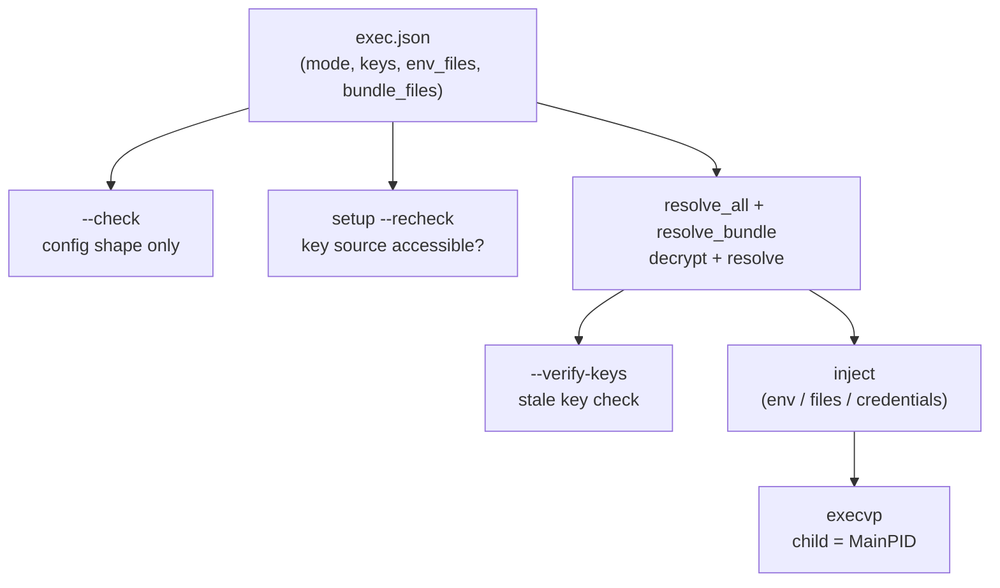

# Launcher contract (exec.json)

## Audience quickstart

This reference defines the fields, modes, and validation rules for `exec.json`.
Deployment integrations must generate this format.

### Who this is for

| Reader | What to take |
| -------- | ------------ |
| Integration author | The entire page — your binding must produce this exact format |
| Security engineer | "Fail-closed rules" and per-mode validation |
| New user | "Invocation" and the config example — enough to get started |
| Platform / SRE | "Invocation" and `--check` / `--recheck` validation commands |

### Quick glossary

| Term | Plain meaning |
| ------ | --------------- |
| **exec.json** | JSON config that selects inputs, key sources, and projection mode. The launch command follows `--` separately. |
| **Projection mode** | How secrets reach the child: env, files, or credentials |
| **Key source** | Where the decryption key comes from (file, credential, keychain, env) |
| **Strict** | If true, dotenv decryption failures abort launch. Bundle authentication failures abort under either setting. |
| **Passthrough** | In files mode, specific keys also exported as env vars |

`postmaster exec` is the concrete instance of the
[materialization ABI](../architecture/materialization-abi.md).
The config accepts dotenv inputs through `env_files` and JSON bundles through
`bundle_files`. They use `DOTENV_PRIVATE_KEY*` and `POSTMASTER_KEY` respectively;
`mode` selects output projection. This page documents the parser and launcher
behavior; the ABI page records how this contract fits into the broader
format-neutral architecture.

`postmaster exec` is a second entry point alongside the credential daemon:
instead of serving decrypted values over a socket, it decrypts once, injects
them into a child process by one of three modes, and `execvp`s a target
command. It exists so that bindings that cannot rely on systemd's
`LoadCredential=` socket contract — Ansible, Puppet, Terraform/CDK,
hand-rolled process supervisors, or nix-darwin's launchd — get the
same decrypt-and-inject semantics as the Linux daemon path, without
templating shell or re-implementing the crypto.

This is the cross-binding contract. Nix and other deployment integrations
emit the same `exec.json` format.
Bindings must emit configs accepted by the parser and check their behavior
against the conformance suite. Host permissions, key availability, and
service-manager wiring require separate validation.

### Config to launch flow



## Reference implementation

The `.env` semantics this contract mirrors — encrypted-value format,
`.env.keys` rotation via comma-separated candidates, `DOTENV_PRIVATE_KEY*`
naming, `--strict`/`--overload` precedence — are wire-compatible with
[dotenvx](https://github.com/dotenvx/dotenvx)-encrypted `.env` files.
`postmaster exec` decrypts natively in Rust, using the same dotenv ECIES
path as the daemon. It does not invoke an external encryption CLI.
Platform checks can invoke verified system tools, as described below.

## Invocation

```console
$ postmaster exec --config <exec.json> -- <command> [args…]
$ postmaster exec --config <exec.json> --check
$ postmaster exec --config <exec.json> [--verify-keys] -- <command> [args…]
$ postmaster setup --config <exec.json> [--recheck] [--unattended] [--force] [--keys-dir <path>]
$ postmaster cleanup --config <exec.json>
```

- `--config <path>` is required and must come before `--`.
- Everything after `--` is the argv of the child process; it must be
  non-empty (`exec: missing command after` `` `--` `` otherwise).
  Unix paths and child arguments preserve non-UTF-8 bytes.
- `--check` validates the public config shape and exits without decrypting,
  reading key material, checking the filesystem, fetching sockets, or
  launching the child command. It does not accept a command after `--`.
  `--check` conflicts with `--verify-keys`.
- `--verify-keys` performs a preflight check: after loading and decrypting,
  if any value was skipped because the key ring could not decrypt it
  (stale keys from a previous rotation cycle), the exec aborts with a
  clear error naming the key. This catches the `strict: false` case where
  stale keys would otherwise silently skip undecryptable values and
  launch the child with a partial or empty secret set. Bundle files need
  no such check: bundle resolution is all-or-nothing, so a stale bundle
  key already aborts the exec regardless of `strict`.
- `setup` prepares the keys directory, checks custody of configured key files
  or creates them with 0600 permissions, and optionally seeds configured macOS
  Keychain items before checking key source access. `--recheck` runs only the
  access and custody checks, without provisioning or parsing key material.
  `--unattended` fails when setup needs operator input.
  `--force` prompts to replace key files or re-seed Keychain items.
  `--keys-dir` overrides the default path (`/var/lib/postmaster` on Linux,
  `~/Library/Application Support/postmaster` on macOS — falling back to
  `/var/lib/postmaster` when `HOME` is empty or unset).
  `--recheck` conflicts with `--force`. Credentials mode requires no private
  keys; setup validates that mode without creating a keys directory.
  **`--check` validates config shape only, not key source accessibility:**
  a config can pass `--check` in CI but fail at runtime because the key
  file is missing, the keychain item is absent, or the credential source
  is not provisioned. Runtime key source accessibility is verified by the
  launcher itself (fail-closed on missing/unreadable keys); `--check`
  cannot guarantee the handoff will work, only that the config is
  well-formed.
- On success the process image is replaced (`execvp`); postmaster never
  returns. On failure to exec the target binary itself, the error is logged
  and returned as a non-zero exit — nothing beyond this point is
  fail-open.

## `ExecConfig` fields

`exec.json` deserializes into this struct (`src/exec_config.rs`).
Unknown root fields are rejected. ABI fields such as `version` or
`adapter` must not be emitted until the parser and schema explicitly define
them. A machine-readable JSON Schema for this current shape is kept at
`docs/schema/exec.schema.json`, with parser-checked examples under
`docs/examples/`.
Every field except `mode` has a default, so a minimal config is just
`{"mode": "credentials", "credential_keys": ["DB_URL"]}`.

| Field | Type | Default | Meaning |
|---|---|---|---|
| `mode` | `"env" \| "files" \| "credentials"` | — (required) | Injection mode; see below. |
| `keys` | array of key-source specs | `[]` | Ordered list of where to obtain `DOTENV_PRIVATE_KEY*` / `POSTMASTER_KEY` material. Unused in `credentials` mode. |
| `env_files` | array of paths | `[]` | Encrypted `.env[.<environment>]` files, in precedence order (first file wins unless `overload`). `env`/`files` modes require at least one of `env_files` or `bundle_files` non-empty. |
| `bundle_files` | array of paths | `[]` | Encrypted `postmaster_bundle` JSON containers, resolved after `env_files`. The first definition wins unless `overload` selects the last; bundle keys use the same identifier rule and injection modes. |
| `strict` | bool | **`true`** | Undecryptable dotenv values abort launch when true and are omitted when false. Bundle authentication failures always abort. |
| `overload` | bool | `false` | File-derived values override the process environment; later files override earlier ones. |
| `secrets_dir` | path or `null` | `null` | `files` mode, and `credentials` mode on the socket-fetch path: directory plaintext files are written into. |
| `passthrough` | array of strings | `[]` | `files` mode only: these keys are *also* exported as real env vars, in addition to their `_FILE` pointer. |
| `credential_keys` | array of strings | `[]` | `credentials` mode: keys to expose as `$CREDENTIALS_DIRECTORY/<KEY>`. Required (non-empty) for that mode. |
| `sockets` | map of key → socket descriptor | `{}` | Each descriptor requires `path`, `protocol`, and `server_uid`. Non-empty selects local Unix socket fetching on either OS; empty means systemd already materialized the credentials via `LoadCredential=`. |
| `verify_ramdisk` | path or `null` | `null` | darwin only: require a RAM-backed HFS mount and a service-owned `secrets_dir` on that device. The verified directory handle is retained for plaintext I/O. |

Note the field name is `verify_ramdisk`, not `ramdisk` or `ramdisk_mount` —
match it exactly.

Mode-required fields are enforced by `postmaster exec --check` and again
before a real launch:

- `env` requires non-empty `keys` and at least one of `env_files` or
  `bundle_files` non-empty.
- `files` requires non-empty `keys`, at least one of `env_files` or
  `bundle_files` non-empty, and `secrets_dir`.
- `credentials` requires non-empty `credential_keys`. If `sockets` is
  non-empty, it also requires `secrets_dir` and a socket mapping for every
  credential key. Extra mappings are rejected.

A socket descriptor names the endpoint, its protocol, and the expected
kernel-reported listener UID:

```json
{
  "path": "/run/postmaster-credd/myapp/DB_URL.sock",
  "protocol": "framed",
  "server_uid": 0
}
```

`protocol` is `raw` or `framed`; it must match the daemon entry. The launcher
checks `server_uid` before reading any credential bytes. This identifies a
local account, not the daemon executable. On Linux, an activated socket can
report the service manager's UID captured at `listen()`, rather than the UID
of the process accepting connections. The UID belongs in trusted deployment
configuration.

**One `secrets_dir` per service.** Startup pruning and exit cleanup can
remove another service's live files in a shared directory. If two launches
share the directory and effective UID, a later launch can replace a file
at a path already exported to the first service. The first service can
then read the later launch's value when it opens that path. Use separate
directories or mounts, such as a namespace-private tmpfs per Linux unit
or per-service directories on a macOS RAM disk.

`--check` also validates env-file basenames, rejects private-key
`file` sources under `/nix/store`, rejects path-like `credential` source
names, and applies identifier validation to `passthrough` and
`credential_keys`.

**Mode-irrelevant fields are rejected.** `--check` and the pre-launch
validation fail fast if a config includes fields that do not belong to the
selected mode — before any secret material transits. This catches binding
bugs where a config generator accidentally emits, for example, `env_files`
in a credentials-mode config or `credential_keys` in an env-mode config.
Default values are accepted, since serde fills those in when the generator
omits the field. `strict` defaults to `true`; credentials mode rejects
`strict: false` because it performs no decryption.

| Mode | Rejected if present (non-default) |
|---|---|
| `env` | `secrets_dir`, `credential_keys`, `sockets`, `verify_ramdisk`, `passthrough` |
| `files` | `credential_keys`, `sockets` |
| `credentials` | `keys`, `env_files`, `bundle_files`, `overload`, `passthrough`, `strict: false` |

The systemd credentials path, selected by empty `sockets`, also rejects
`secrets_dir` and `verify_ramdisk`. Those fields apply only when Postmaster
writes plaintext files. The JSON Schema covers these field rules; the parser
also checks that socket mappings match `credential_keys` exactly.

## Key-source list (`keys`)

Each entry in `keys` is one externally-tagged JSON shape:

| JSON | Meaning |
|---|---|
| `{"credential": "<name>"}` | `$CREDENTIALS_DIRECTORY/<name>` (the launcher's *own* `LoadCredential`, i.e. `.env.keys` handed to it the same way postmaster's daemon receives its own). `<name>` must be a single relative path component, not `.`, `..`, an absolute path, or a slash-containing path. |
| `{"file": "<path>"}` | An out-of-store `.env.keys`-format file read directly. Rejected outright if the path starts with `/nix/store` — private keys must never live in the world-readable store. |
| `{"keychain": "<service>"}` | macOS keychain (the default keychain search list); one generic-password item per `DOTENV_PRIVATE_KEY[_<ENV>]` account, service name as given. Only the variables actually needed (derived from `env_files` and `bundle_files`) are fetched. Any other target: error, "only available on macOS". |
| `"environment"` | The unit-variant source — note it is a bare JSON string, not an object, because it carries no data. Reads `DOTENV_PRIVATE_KEY*` (and `POSTMASTER_KEY` when `bundle_files` are configured) straight from postmaster's own process environment. |

**Bundle key variable.** With `bundle_files` configured, the ring admits
`POSTMASTER_KEY` material in the same sources: comma-separated rotation
candidates are admitted, and `POSTMASTER_KEY_<suffix>` variants match by
the same predicate as `DOTENV_PRIVATE_KEY_*`. There is no
per-environment filename mapping — every bundle file resolves against
the one `POSTMASTER_KEY` variable. `profile` and `recipients` are public
metadata; they do not select keys. Bindings select the bundle paths.

**Application environment.** In every projection mode, the launched command
does not receive `DOTENV_PRIVATE_KEY`, `POSTMASTER_KEY`, or their
`_<nonempty suffix>` variants. This applies regardless of the selected key
source and after all projected values are added. Other inherited variables,
including `PATH` and `HOME`, are preserved. Dotenv and bundle entries using
these reserved private-key names are rejected before launch, even with
`strict: false`. Plaintext dotenv substitution cannot read either private-key
namespace from the environment or earlier assignments. Single-quoted
references remain literal.

**Selection contract**, evaluated in list order:

- `credential` is **skippable**: if `$CREDENTIALS_DIRECTORY` is unset, or
  the named file doesn't exist under it, the launcher falls through to the
  next entry in `keys`. If the file *does* exist, whatever
  `KeyRing::load` returns (success or parse error) is final — a bad
  keys file under an existing credential does not fall through.
  A set `$CREDENTIALS_DIRECTORY` must be absolute and nonempty. Existing
  credential key files receive the same opened-inode ownership, permission,
  type, and macOS ACL checks as file sources. Setup's access check follows the
  same selection and custody rules without parsing key material.
- `file`, `keychain`, and `environment` are **terminal**: the first time
  one of these is reached, its result — success or failure — is the
  result of key-ring selection. There is no fallback past a terminal
  source.
- If every entry in `keys` is exhausted without returning (i.e. every
  entry was a skippable, absent `credential`), or `keys` is empty:
  `"no usable key source (configure keys=[…] or set DOTENV_PRIVATE_KEY*)"`.

`credentials` mode never touches `keys` or `env_files` at all — no
decryption happens in that mode; see below.

## Precedence contract

The launcher resolves `env_files` first, followed by `bundle_files`.
Both adapters follow this contract:

- **Within one file, the last assignment wins** — ordinary dotenv
  semantics. `A=1` followed later in the same file by `A=2` yields `2`.
- **Across files, the first file that defines a key wins**, in the order
  the lists specify — *unless* `overload` is `true`, in which case
  the **last** file defining the key wins. Note: which file wins does not
  change the *position* a key is emitted in; a key's slot is fixed by
  the first file that introduces it, `overload` only changes which
  file's value fills that slot.
- **Process-environment presence suppresses the file-derived value**,
  but only when `overload` is `false`: if the variable is already set
  in postmaster's process environment, it is dropped from the resolved
  set entirely (the child inherits the parent's existing value
  unmodified, except for reserved private-key variables). When `overload`
  is `true`, process environment
  is not consulted at all — file values always win.

## Dotenv input limits

Dotenv sources must be regular files; final symlinks and special files fail
before parsing. Each file is limited to 16 MiB. A resolution pass allows at
most 64 MiB of source bytes, 65,536 assignments, and 64 MiB of parsed names and
values across all dotenv files. Each expanded value is limited to 16 MiB.
Duplicate assignments and metadata count toward these limits before filtering.

Expansion checks run before appending or retaining substituted values, so a
small substitution chain cannot allocate an unbounded result. Quoting,
multiline values, environment-first substitution, and precedence stay the
same. Syntax errors name the file and error category without including its
contents. Resource-limit failures abort even with `strict: false`.

## `DOTENV_` filtering and identifier validation

- Private-key names in either adapter namespace are rejected. Other raw keys
  beginning with `DOTENV_` are dropped as metadata, never values to inject.
  The daemon also refuses metadata and private-key names as served credentials.
- Every remaining key must match `[A-Za-z_][A-Za-z0-9_]*`
  (`crate::keys::is_ident`) — ASCII letters/digits/underscore, first
  character not a digit. A key that fails this is a hard parse error
  (`"<file>: refusing non-identifier key <k>"`), not a skip: a key from
  an encrypted file will end up as a shell-visible env-var name or a
  filename component, so this is enforced before any value from that
  file is used at all.
- `credential_keys` (used only in `credentials` mode, where there is no
  `resolve_all` pass) is validated against the same `is_ident` rule
  up front, before any file is written or any socket is fetched
  (`validate_credential_keys`) — a bad key later in the list (e.g.
  `"../evil"`, an absolute path, or a name containing `/`) can't leave a
  partial plaintext write behind, and can't be used to escape
  `secrets_dir` or forge an arbitrary env-var name.

## Encrypted-value format

Values are first parsed with dotenvy-compatible quoting and variable
substitution rules. A parsed value without `encrypted:` needs no decryption
and is passed through as bytes. A value that starts with `encrypted:` has the
following payload base64-decoded and decrypted with `ecies` against each
candidate key under the matching `DOTENV_PRIVATE_KEY*` name
(comma-separated rotation candidates in `.env.keys` are tried in order;
first one that decrypts wins).

Decrypted plaintext and bundle entries are not interpolated. For a plaintext
dotenv value, single quotes preserve `${VAR}` literally; unquoted and
double-quoted values can substitute variables. No value is evaluated as shell
code, and `$(cmd)` does not run a command. References to `DOTENV_PRIVATE_KEY`,
`POSTMASTER_KEY`, and their nonempty suffix variants fail rather than copying
private keys into an ordinary output variable.

**Lenient base64 decoding:** the payload after `encrypted:` may contain
ASCII whitespace (spaces, tabs, newlines, carriage returns). If any is
present, it is stripped before decoding, so a value that has been
line-wrapped decodes identically to the same value on one line. This
matches the wire-compatible behavior for line-wrapped encrypted values and
is exercised directly in `tests/exec_conformance/main.rs`
(`wrapped_base64_ciphertext_decrypts`).

`key_var_for` maps an env-file name to the private-key variable it needs:
`.env` → `DOTENV_PRIVATE_KEY`; `.env.production` →
`DOTENV_PRIVATE_KEY_PRODUCTION`. The environment suffix must be non-empty
and contain only `[A-Za-z0-9_]` after upper-casing — anything else is a
hard parse error (no lossy mapping: `.env..x` and `.env._x` must never
alias). A file name that doesn't start with `.env` is a hard parse error.

## Per-mode injected variables

**`mode: "env"`.** Decrypts `env_files` and `bundle_files` through the key ring
in `keys`,
then exports every resolved `KEY=value` pair directly into the child's
environment. No pointer files, no `secrets_dir`. A resolved value
containing a NUL byte is a hard error
(`"<key>: value contains a NUL byte; cannot be an environment variable
(use files mode)"`) — environment variables cannot hold NUL, so this fails
closed rather than silently truncating.

**`mode: "files"`.** Requires `secrets_dir`. If `verify_ramdisk` is set,
the ramdisk guard (below) runs first. The directory must exist and its complete
pathname must be protected from less-trusted replacement. Root and the
effective user are trusted owners; sticky shared parents and trusted symlink
aliases remain supported. The launcher exports the verified canonical path.
Each value is written byte-exact to a fresh exclusive 0600 inode and published
atomically as `<secrets_dir>/<KEY>`. Existing handles keep the old contents;
foreign, hardlinked, symlinked, and special existing entries fail closed.
The write also rejects filenames that resolve to an existing entry with a
different spelling, such as `Case` and `CASE` on a case-insensitive filesystem.
Values may contain NUL. For each key
the launcher exports `<KEY>_FILE` pointing at that path; if the key is
also listed in `passthrough`, it is *additionally* exported as a real
`<KEY>=value` env var (and *that* copy is subject to the same NUL-rejection
rule as `env` mode, since it becomes a real env var).
If a passthrough name collides with another key's `_FILE` pointer, launch
fails before starting the application and attempts to remove materialized
secret files. Names ending in `_FILE` remain valid when their projections do not
collide.

**`mode: "credentials"`.** Requires non-empty `credential_keys`
(validated as identifiers up front, see above). No decryption occurs in
this mode — it dispatches on whether `sockets` is empty:

- **`sockets` empty (systemd path):** pid 1 has already materialized the
  credentials via `LoadCredential=` before the unit's `ExecStart` runs.
  Requires `$CREDENTIALS_DIRECTORY` to be set in the *process*
  environment (`"postmaster credentials expected but
  CREDENTIALS_DIRECTORY is unset"` otherwise — a fail-closed guard
  against running this mode outside systemd). The directory must be absolute.
  Every named credential must exist as a regular file; final symlinks and
  special files fail. For each key, exports
  `<KEY>_FILE=$CREDENTIALS_DIRECTORY/<KEY>` without reading values or changing
  permissions; systemd already owns those files.
- **`sockets` non-empty (local fetch path):** requires
  `secrets_dir`; runs the ramdisk guard if `verify_ramdisk` is set. For
  each key, looks up its socket descriptor in `sockets`, verifies the connected
  peer UID, and reads with the selected protocol through the same client path
  as `postmaster fetch`. Only a complete accepted response is written to
  `<secrets_dir>/<KEY>` at `0600`. As in files mode, a write rejects a name
  that resolves to an existing entry with a different spelling. The launcher
  exports `<KEY>_FILE`. After all keys, it also exports
  `CREDENTIALS_DIRECTORY` set to `secrets_dir`
  so the application can use the same credential-directory convention.
  This path is normally used with launchd, but `sockets` selects it on
  either supported operating system.

### Local socket protocols

Both protocols use local Unix sockets. No remote transport is involved.
The daemon's optional per-entry `protocol` defaults to `raw` so systemd can
read the socket directly with `LoadCredential=`.

- `raw` sends credential bytes followed by EOF. An empty response fails, but
  EOF cannot distinguish a shorter valid secret from a truncated longer one.
- `framed` sends a 12-byte header: `PMCR\x00\x00\x00\x01`, then the payload
  length as an unsigned 32-bit big-endian integer. The length must be between
  1 byte and 16 MiB. Exactly that many payload bytes and EOF must follow.
  Unknown versions, partial headers or payloads, and extra bytes fail.

Connect and read share one five-second deadline. A framed fetch requires an
explicit expected UID. Standalone raw `fetch` can also check a UID with
`--server-uid`; the launcher's socket descriptors always require one. UID
verification authenticates the listener account, not an executable or another
process using the same account.

## Fail-closed rules

- **`strict` (default `true`).** In `env`/`files` modes, if a selected dotenv
  value fails to decrypt (bad key, wrong key, malformed ciphertext), the whole
  exec aborts before the child runs — nothing partial is injected. With
  `strict: false`, an undecryptable value is logged and omitted
  from the resolved set (never served as an error string or empty value).
  Bundle entries must authenticate regardless of `strict`. `--verify-keys`
  also rejects skipped dotenv values when `strict` is false.
- **NUL in an environment value** is refused in `env` mode and for
  `passthrough` values in `files` mode (see above); in `files` mode's
  primary write path (the pointer-file contents), NUL is not restricted
  — the exact bytes reach the file.
- **Empty fetch response** (`credentials` mode, local sockets on Linux or macOS):
  The launcher rejects empty responses before writing a credential file.
  Raw responses must contain bytes; framed responses must declare and deliver
  a nonzero payload.
- **16 MiB read cap.** Config JSON, bundle JSON, private-key files, setup
  input, and credential fetch payloads are capped at 16 MiB; oversized input
  fails. Dotenv
  sources have the separate byte, assignment, and expansion limits described
  above. Config, bundle, and key reads reject nonregular files without blocking
  on FIFOs. Public config aliases are supported; bundle and key final symlinks
  remain refused.
- **Missing systemd credentials.** An unset, empty, or relative
  `$CREDENTIALS_DIRECTORY`, or a missing or nonregular credential, fails before
  the systemd credentials branch launches the application.
- **Private keys never come from the Nix store.** A `{"file": …}` key
  source under `/nix/store` is refused outright, even before attempting
  to read it — the store is world-readable, so a private key living
  there is not private.
- **Keys file permissions and ownership.** `KeyRing::load` opens the
  keys file with `O_NOFOLLOW` and `fstat`s the fd to verify: no
  group/world access (`mode & 0o077 == 0`), and owned by the current
  euid. A world-readable or symlinked keys file fails closed. On macOS,
  runtime loading and setup rechecks also reject ACL grants that let
  principals other than root or the effective user read or modify the file.
  These checks do not change the source file's ACL.
- **External binary verification.** Keychain access uses the
  Security.framework API in-process — no external binary is invoked for
  it. The external binaries postmaster does invoke (`/usr/bin/id`,
  `/sbin/mount`, `/usr/bin/hdiutil` on macOS) are verified first:
  `codesign -v` on macOS; on Linux, verified as regular files owned by
  root (uid 0) with no group or other write permissions. Linux `id` lookup
  resolves system aliases, verifies the target and its directory ancestry,
  then invokes that resolved target. This includes the NixOS system profile.
- **`verify_ramdisk` (darwin ramdisk guard).** When set, before any
  plaintext is written the launcher runs two checks: it shells out to
  `/sbin/mount` and requires the configured mount point to appear as an
  `hfs` filesystem, then runs `hdiutil info` and requires the device's
  `image-path` to start with `ram://` (confirming RAM backing, not a
  file-backed image). It opens `secrets_dir` without following a
  final-component symlink and checks the pinned inode's ownership and
  backing device. The directory must be lexically beneath the mount point
  and use the verified RAM device, so an intermediate symlink cannot
  redirect plaintext onto persistent storage. Pruning, writes, cleanup,
  and the monitor retain that same directory handle.

## Extensibility boundary

`KeySourceSpec` is the boundary between postmaster and the systems around
it. The implemented source kinds are deliberately local and terminal:
`credential`, `file`, `keychain`, and `environment`. postmaster rejects any
unknown key-source kind at JSON-parse time; an unknown tag is a
deserialize error, not a silently-ignored source.

Provider names such as `vault` and `aws_ssm` are reserved for the contract,
but native network key sources are out of scope for the current threat
model. postmaster must not become an AWS SSM client, a Vault client, or a
general secret-store plugin host. Those systems are supported as upstream
custody/source platforms: they deliver `.env.keys`-format private-key
material into one of the implemented local sources, and postmaster remains
the offline runtime decrypt/inject boundary.

The obligations run in different directions for postmaster and for
bindings:

- **postmaster** validates the `exec.json` shape, enforces the implemented
  source semantics, decrypts locally, injects locally, and fails closed.
- **A binding** must only emit source kinds it actually knows the semantics
  of. A binding that generates configs should treat an unrecognized source
  kind in its own templates as a bug in itself, not rely on postmaster to
  validate binding-author intent.

## Composition recipes

None of these need new code in postmaster, and none of them put a network
client in postmaster's secret path. They compose the local key sources
with external secret-management tooling that materializes a
`DOTENV_PRIVATE_KEY*` file, credential, or keychain item before
`postmaster exec` runs:

- **Vault Agent → `{"file": …}`.** Point a Vault Agent template at
  rendering a `.env.keys`-format file (owned by the service user, off
  any world-readable store path) and reference it with
  `{"file": "/run/vault/myapp.env.keys"}`. Vault Agent owns Vault auth,
  network I/O, renewal, and rotation; postmaster only ever reads the
  rendered local file.
- **AWS SSM Parameter Store → `{"credential": …}`.** Materialize the
  parameter via a oneshot unit, cloud-init, an instance bootstrap step, or
  `systemd-creds` for TPM2 sealing on NixOS into the launcher's own
  `LoadCredential=` directory, then reference it as
  `{"credential": "postmaster-myapp"}`. AWS tooling owns IAM, network I/O,
  and retrieval; postmaster inherits systemd's local credential access
  control.
- **macOS Keychain → `{"keychain": "<service>"}`.** Use
  `postmaster setup` to seed the required accounts under that service name.
  Postmaster reads those items through Security.framework. See
  [Key provisioning](../getting-started/key-provisioning.md#strategy-d-macos-keychain).

## Conformance

`tests/exec_conformance/main.rs` is the executable form of this document:
metacharacter-laden values stay inert in `env` mode,
process-env-wins-without-overload and overload-reverses-it, rotation with
a bogus first key, strict failure refuses to exec, `0600` pointer files
and `passthrough`, both `credentials` branches (systemd pointer-only and
local socket fetching), first-file/last-file precedence, same-file
last-assignment-wins, NUL-in-value handling in both `env` and `files`
modes, stale-key detection with `--verify-keys`, and non-identifier key
rejection at the exec boundary. Any binding — Ansible, Puppet, Salt, CDK,
or anything else that can render JSON — is correct precisely to the extent
that the `exec.json` it emits matches this document and that emitted
config passes this suite.
